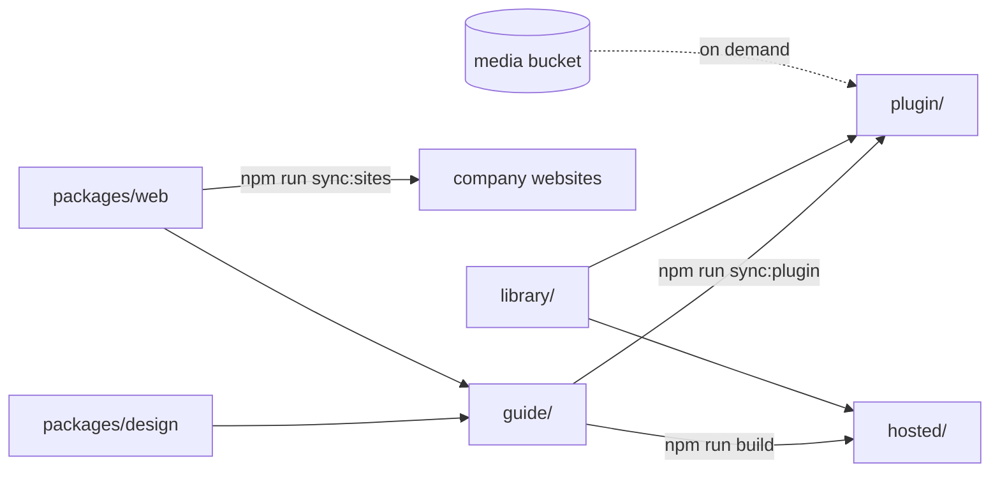

# AIS Group design system

The single source for how the AIS Group brands look, read and are built: the brand guide, the product and website components, the Claude Code plugin that makes on-brand material, and the hosted MCP that serves all of it to agents.

| Live | Where |
| --- | --- |
| Brand guide | https://design.aisgroup.ai |
| Hosted MCP (read-only) | https://design.aisgroup.ai/mcp |
| Product components | `@rosepetal/design` in the company's private package registry (Artifact Registry) |
| Claude Code plugin | This repository, as a plugin marketplace |

## Repository layout

| Folder | What it is | Published as |
| --- | --- | --- |
| [`guide/`](guide/) | The brand guide (Astro), in English, Spanish and Catalan: brand, design language, communications, websites and the product design system. | design.aisgroup.ai (Firebase Hosting) |
| [`packages/design/`](packages/design/) | `@rosepetal/design`: the product components (shadcn-vue), brand blocks, examples and product tokens (`styles.css`). | npm package, Artifact Registry |
| [`packages/web/`](packages/web/) | `@aisgroup/web`: the websites' Astro components, examples and web tokens. | Copied into each company website |
| [`packages/vue-themes/`](packages/vue-themes/) | PrimeVue and Vuetify presets generated from the product tokens. | Served by the guide and the MCP |
| [`playground/`](playground/) | A Vite app to try the product components and tune their variables. | Local only |
| [`plugin/`](plugin/) | The Claude Code plugin: the guide as skills, and the studio MCP that makes posts, carousels, brochures, datasheets and decks. | Claude Code plugin |
| [`hosted/`](hosted/) | The read-only MCP: rules, tokens, component code and assets for developers and claude.ai. | Firebase function behind the guide |
| [`library/`](library/) | The media catalogue: every approved photo and render, with its origin and rights. The files themselves are in the media bucket. | Read by both MCPs |
| [`scripts/`](scripts/) | Contract checks and sync tools used by `npm test` and the release steps. | |

## How the parts fit together

Each kind of content has one source. Everything else is generated from it and checked for drift.



- **Components** change only in `packages/design` and `packages/web`. The guide's component pages, its shadcn-vue registry (`/r/<name>.json`), its agent index (`/components.md`) and its theme download are built from the packages; the guide never keeps a copy.
- **Brand rules** change only in the guide's pages. The plugin's knowledge skills and `plugin/brand/` are copies of the built guide, and the hosted MCP serves a snapshot of it.
- **Shared tokens** (the blue and neutral scales, the font, the status colours) live in both `packages/design/styles.css` and the guide's `ais-tokens.css`. `npm test` fails if they differ.

[`plugin/docs/HOW-IT-WORKS.md`](plugin/docs/HOW-IT-WORKS.md) describes both MCPs in detail. [`CONTRIBUTING.md`](CONTRIBUTING.md) has the rules for each part.

## Getting started

Requires Node 22 and npm 10. The repository is one npm workspace: a single install at the root covers every part.

```bash
git clone https://github.com/rosepetal-ai/aisgroup-design.git
cd aisgroup-design
npm ci
npm run build
npm test
```

| Command | What it does |
| --- | --- |
| `npm run dev:guide` | The guide at http://localhost:4321 |
| `npm run dev:playground` | The playground at http://localhost:5173 (one component at `/#<id>`) |
| `npm run build` | Builds the guide, the playground and the hosted MCP's snapshot |
| `npm test` | Every check: tokens contract, package typecheck, plugin and hosted MCP tests, component, website and spec contracts, guide search. Run after a build |
| `npm run sync:plugin` | Copies the built guide into `plugin/`; commit the result with the guide change |
| `npm run sync:sites` | Copies `@aisgroup/web` into the company websites checked out next to this repository |
| `npm run <script> -w <workspace>` | Any script of one part, for example `npm run typecheck -w @rosepetal/design` |

The plugin's studio also needs Chromium and Python packages. `npm run setup -w plugin` installs them once per computer.

## Quality gates

CI ([`.github/workflows/ci.yml`](.github/workflows/ci.yml)) runs on every push and pull request: `npm ci`, `npm run build`, `npm test` and the check that the plugin's copies match the guide. It uses no secrets and deploys nothing. Pull requests go into `dev` and need the code owners of every folder they touch ([`.github/CODEOWNERS`](.github/CODEOWNERS)).

## Media and the marketing kit

Photos, renders and videos (`media/`) and the delivered marketing kit (`marketing-kit/`) are kept in the private Cloud Storage bucket `gs://aisgroup-design-assets`, not in git. The studio downloads each picture the first time a piece uses it, so nobody needs the whole library.

| Command | What it does |
| --- | --- |
| `npm run media:pull` | A full local copy of the media library, for offline work and the media tests |
| `npm run media:push -w plugin` | Uploads new or changed media; never deletes |
| `npm run kit:pull` / `npm run kit:push` | Downloads or uploads the marketing kit; then `npm run kit -w guide` refreshes the guide's kit pages |

## Releasing

Releases are manual, from an up-to-date `dev` after `npm ci && npm run build && npm test`.

| Part | How |
| --- | --- |
| Guide | `npm run deploy:guide`: builds, then deploys to the Firebase site `aisgroup-design` |
| Hosted MCP | `cd guide && firebase deploy --only hosting:aisgroup-design,functions:mcp --project aisgroup-design`, after a guide build. The predeploy step snapshots the guide into `hosted/data`. Limits and costs: [`hosted/README.md`](hosted/README.md) |
| `@rosepetal/design` | Push a tag `vX.Y.Z`. The [`publish-design`](.github/workflows/publish-design.yml) workflow sets that version, checks the package and publishes it |
| Plugin | Merge to `dev`. Bump the version in `plugin/.claude-plugin/plugin.json` when the skills or the studio change |

Install the plugin in Claude Code:

```
/plugin marketplace add rosepetal-ai/aisgroup-design
/plugin install ais-group-design@ais-group-design
```

Install the package in an app: authenticate once with `npm_config_registry=https://registry.npmjs.org npx google-artifactregistry-auth`, then follow [`packages/design/README.md`](packages/design/README.md).

## Access

All Google Cloud roles are on the `aisgroup-design` project.

| To | You need |
| --- | --- |
| Build, test and run the guide locally | Read access to this repository |
| Use the plugin's studio with brand media | «Storage Object Viewer», the [Google Cloud CLI](https://cloud.google.com/sdk/docs/install) and `gcloud auth login` |
| Upload media or the marketing kit | «Storage Object Creator» |
| Deploy the guide | Firebase Hosting access and `npx firebase-tools login` |
| Deploy the hosted MCP | «Firebase Admin» and «Service Account User» (`roles/iam.serviceAccountUser`); the project is on the Blaze plan |
| Publish `@rosepetal/design` | A version tag; the workflow uses the repository secret `GCP_SA_KEY` |
| Install `@rosepetal/design` | Read access to the `private-node-packages` registry |

## Licence

Proprietary. See [`LICENSE`](LICENSE).
