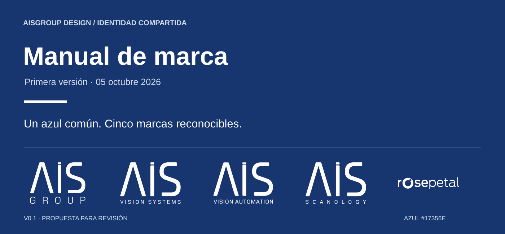
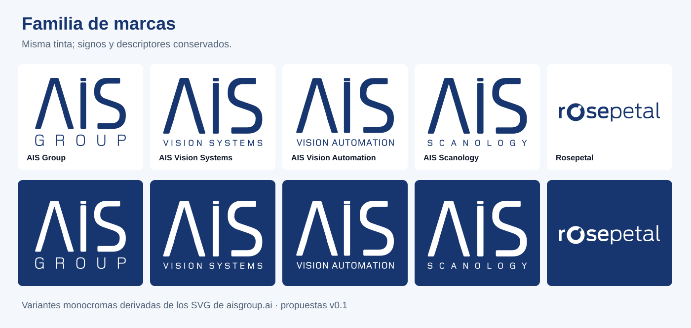
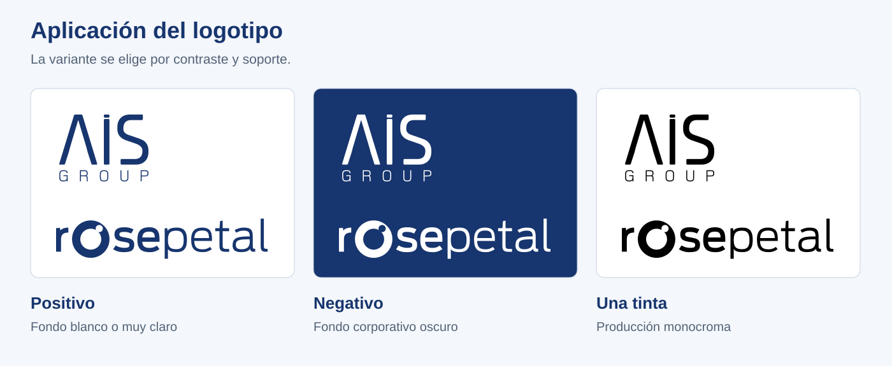
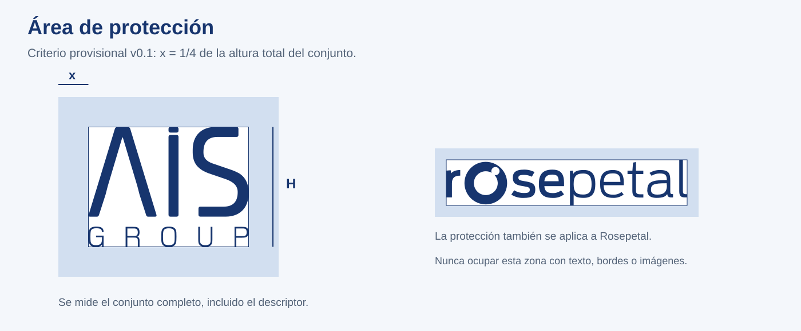
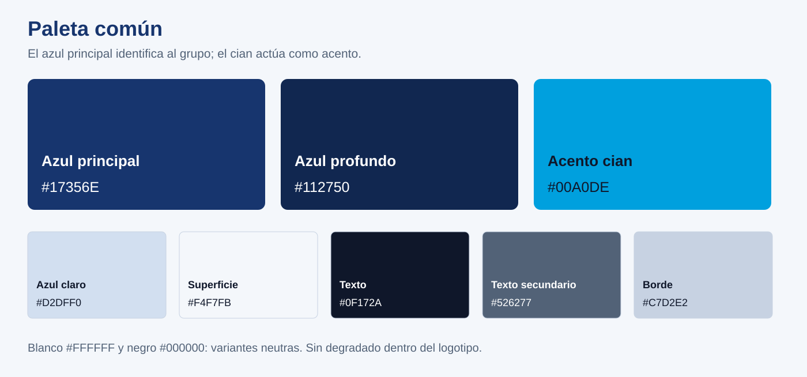
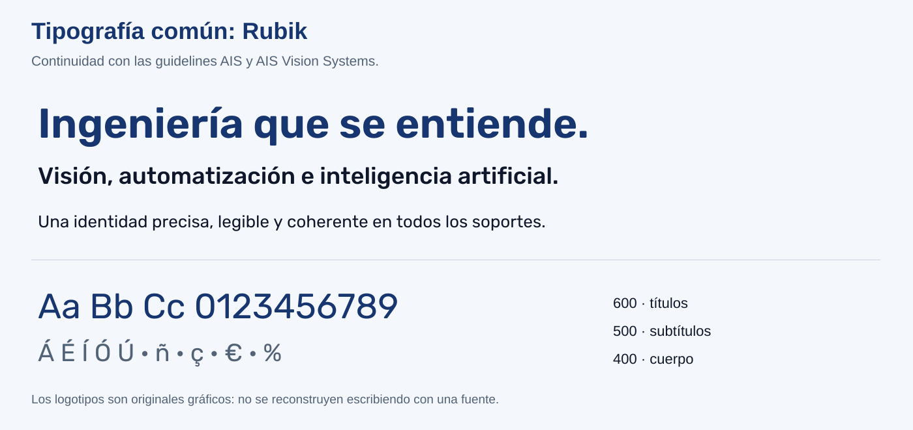
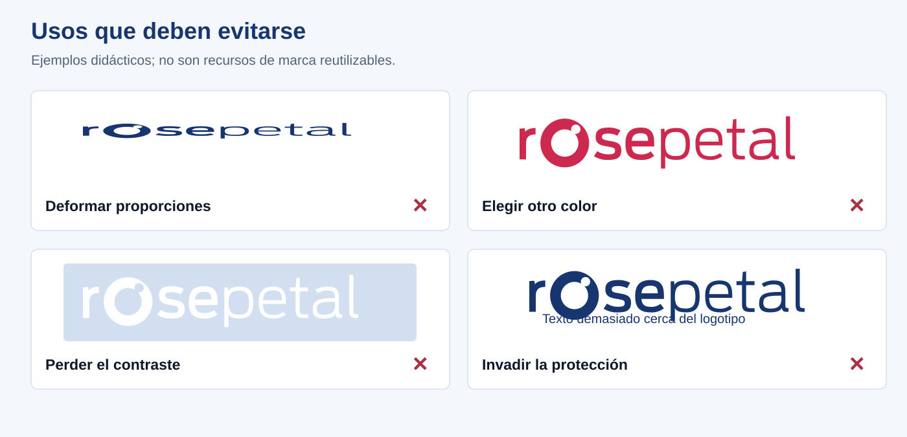
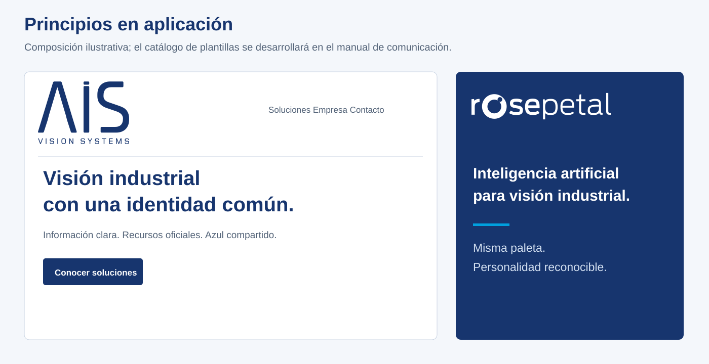

# Manual de marca AIS Group

**Versión 0.1 · 5 de octubre de 2026 · Propuesta para revisión**

Este manual establece una primera identidad compartida para AIS Group, AIS Vision Systems, AIS Vision Automation, AIS Scanology y Rosepetal. Su objetivo es que las marcas se reconozcan como parte del mismo grupo y conserven sus signos propios.

La decisión de partida es utilizar **un azul común**. Esta versión propone **#17356E** como color principal, logotipos planos y Rubik como familia tipográfica corporativa. Incluye recursos vectoriales utilizables para revisar la propuesta, sin convertirlos todavía en originales finales aprobados.

**Alcance:** identidad, marcas, logotipos, color, tipografía y criterios visuales esenciales. Las plantillas comerciales, campañas, tramas definitivas y componentes de interfaz se desarrollarán en sus respectivos manuales. Las imágenes de aplicación que aparecen aquí son ejemplos del criterio visual.

## Índice

1. [Arquitectura y nombres de marca](#1-arquitectura-y-nombres-de-marca)
2. [Fundamentos de identidad](#2-fundamentos-de-identidad)
3. [Sistema de logotipos](#3-sistema-de-logotipos)
4. [Color corporativo](#4-color-corporativo)
5. [Tipografía](#5-tipografía)
6. [Lenguaje visual](#6-lenguaje-visual)
7. [Usos correctos y prohibidos](#7-usos-correctos-y-prohibidos)
8. [Aplicaciones y convivencia](#8-aplicaciones-y-convivencia)
9. [Recursos y uso por agentes](#9-recursos-y-uso-por-agentes)
10. [Transición y decisiones pendientes](#10-transición-y-decisiones-pendientes)
11. [Fuentes](#11-fuentes)

## 1. Arquitectura y nombres de marca

AIS Group actúa como marca corporativa del conjunto. Las marcas operativas mantienen su identidad y especialidad. Se propone una arquitectura de marcas respaldadas por el grupo, con una base cromática y tipográfica compartida.

| Marca | Función en la arquitectura | Nombre en texto | Web de referencia |
| --- | --- | --- | --- |
| AIS Group | Identidad corporativa y comunicación conjunta | AIS Group | [aisgroup.ai](https://aisgroup.ai/) |
| AIS Vision Systems | Visión artificial e inspección industrial | AIS Vision Systems | [aisvision.com](https://aisvision.com/) |
| AIS Vision Automation | Automatización, marcaje, etiquetado y visión | AIS Vision Automation | [aisautomation.ie](https://www.aisautomation.ie/) |
| AIS Scanology | Etiquetas, códigos de barras y verificación | AIS Scanology | [scanology.nl](https://scanology.nl/) |
| Rosepetal | Software de inteligencia artificial y visión industrial | Rosepetal | [rosepetal.ai](https://rosepetal.ai/) |

Estas denominaciones son de comunicación; no sustituyen los nombres legales de las sociedades. La expresión «Rosepetal AI», presente en la web del grupo, puede emplearse como descriptor comercial. No implica crear una segunda marca gráfica.

### 1.1. Reglas de escritura

- Escribir **AIS** en mayúsculas, también cuando el dibujo del logotipo pueda sugerir «AiS».
- Escribir **Rosepetal** con mayúscula inicial en texto. La minúscula del logotipo pertenece al dibujo y se conserva.
- Mantener «Vision Systems», «Vision Automation» y «Scanology» en sus nombres comerciales; no traducirlos dentro de la marca.
- Utilizar el nombre completo en la primera mención y en comunicaciones externas donde pueda existir ambigüedad.
- **AISGroup Design** es el nombre del proyecto y del sistema de diseño. La firma corporativa continúa siendo **AIS Group**.

### 1.2. Firma y pertenencia al grupo

La marca que presta la solución encabeza su material. AIS Group encabeza la comunicación del grupo o de varias compañías en conjunto.

Para identificar la pertenencia se propone la expresión común **«Part of AIS Group»**, situada como texto de respaldo en un pie, cierre o bloque corporativo. No se incorpora manualmente al archivo del logotipo. Si se necesita una composición fija, debe producirse y registrarse como un recurso específico.

En una pieza conjunta se utiliza una firma principal y un bloque de participantes con peso visual equilibrado. La jerarquía depende del emisor, no de un color distinto para cada empresa.

## 2. Fundamentos de identidad

**Propósito de comunicación:** presentar con claridad la capacidad del grupo para integrar visión, automatización e inteligencia artificial en entornos industriales.

| Principio | Consecuencia en el diseño |
| --- | --- |
| Precisión | Datos legibles, alineaciones claras y diagramas comprensibles |
| Fiabilidad | Consistencia entre materiales, buena legibilidad y pocas variantes |
| Capacidad técnica | Producto, procesos y resultados reales como evidencia visual |
| Cercanía | Lenguaje directo, fotografías de equipos y explicaciones accesibles |
| Unidad | Un mismo azul y un sistema común, con cada marca identificable |

La personalidad debe resultar técnica, clara y segura. Evitar composiciones que dependan de efectos decorativos para transmitir innovación. Las afirmaciones sobre rendimiento, certificaciones o clientes se utilizarán con su fuente y contexto; este manual no convierte los mensajes de las webs en afirmaciones comerciales aprobadas.

## 3. Sistema de logotipos

### 3.1. Base de esta versión

Se parte de los SVG publicados en la web de AIS Group, consultados el 5 de octubre de 2026. Los originales se conservan en [`assets/brand/logos/source/`](../../assets/brand/logos/source/).

Las variantes v0.1 convierten esos recursos a una sola tinta, conservando sus contornos y composición. En AIS Vision Automation se recuperaron los contornos vectoriales que recortaban los degradados rasterizados del SVG original; no se trazaron a partir de una imagen.

Se conservan, por ahora, el detalle de la «I» de AIS, el símbolo de la «o» de Rosepetal y las diferencias de peso de su nombre. El documento de rebranding propone revisarlos; cualquier ajuste geométrico tendrá su propia revisión y no debe surgir de una adaptación improvisada.

### 3.2. Variantes

| Variante | Aplicación |
| --- | --- |
| Azul `#17356E` | Preferente sobre blanco y fondos muy claros |
| Blanco `#FFFFFF` | Sobre azul corporativo o superficies oscuras con contraste suficiente |
| Negro `#000000` | Producción monocroma y soportes que no admitan el azul |

Los archivos se encuentran en [`assets/brand/logos/draft/v0.1/`](../../assets/brand/logos/draft/v0.1/). El estado **draft** indica que forman parte de esta propuesta. Las variantes blancas tienen fondo transparente; una vista previa sobre blanco puede parecer vacía.

**Regla propuesta:** color plano en todo el logotipo, incluido su descriptor. Los degradados, brillos, sombras y efectos tridimensionales quedan fuera de las nuevas aplicaciones de identidad.

### 3.3. Descriptor, respaldo y eslogan

- **Descriptor de marca:** «GROUP», «VISION SYSTEMS», «VISION AUTOMATION» o «SCANOLOGY», cuando forma parte del original. Se mantiene dentro de la composición.
- **Respaldo de grupo:** «Part of AIS Group». Identifica pertenencia y puede aparecer en un bloque independiente.
- **Eslogan:** mensaje de comunicación que puede variar por campaña. No forma parte del logotipo.

Las guidelines anteriores emplean el término *tagline* de forma amplia y exigen acompañar el logo. Esta propuesta conserva los descriptores de marca y permite separar el respaldo del grupo para mejorar su legibilidad. Este cambio respecto a la guía anterior requiere validación antes de sustituir aplicaciones vigentes.

### 3.4. Área de protección

Para esta v0.1 se propone una regla común: **x = 1/4 de la altura total del logotipo**, incluido su descriptor. Mantener al menos una distancia x libre en los cuatro lados, medida desde los extremos visibles de la marca.

Esta zona debe quedar libre de textos, imágenes, bordes y otros logotipos. Los márgenes transparentes que incluya un archivo cuentan para esa distancia, pero no deben confundirse con la dimensión visible de la marca.

La fórmula es una nueva regla operativa de la propuesta; no pretende reproducir una medida numérica de las guidelines anteriores, que presentan una retícula sin cotas explícitas.

### 3.5. Reducción

Valores iniciales conservadores, pendientes de una prueba final en cada soporte:

| Composición completa | Ancho mínimo orientativo en pantalla | Ancho mínimo orientativo impreso |
| --- | ---: | ---: |
| AIS Group | 100 px CSS | 25 mm |
| AIS Vision Systems | 180 px CSS | 40 mm |
| AIS Vision Automation | 200 px CSS | 45 mm |
| AIS Scanology | 160 px CSS | 35 mm |
| Rosepetal | 120 px CSS | 30 mm |

El criterio decisivo es la lectura del descriptor al tamaño final. Si no cabe, ampliar el espacio o recurrir a una variante compacta diseñada y aprobada. No eliminar palabras, reducir el descriptor por separado ni usar una captura de baja resolución. Las variantes compactas y favicons definitivos quedan pendientes.

## 4. Color corporativo

### 4.1. Azul principal

**Azul AIS Group — HEX `#17356E` · sRGB `23, 53, 110`.**

Se propone este tono por tres razones: ya está definido en el manual de Rosepetal; mantiene continuidad con los azules oscuros de AIS; y permite un contraste alto con blanco. La elección es un criterio de diseño, no una media matemática de los colores de las webs.

Las guidelines AIS recogen `#1C2B4E`; sus aplicaciones actuales y las de Rosepetal muestran otros azules próximos. Esta v0.1 fija un valor exacto para evitar que cada pieza elija una nueva aproximación. El [registro de fuentes y decisiones](fuentes-y-decisiones.md) recoge las diferencias detectadas.

### 4.2. Paleta y funciones

| Token | Nombre | HEX | sRGB | Uso |
| --- | --- | --- | --- | --- |
| `color.primary` | Azul principal | `#17356E` | 23, 53, 110 | Identidad, logos, títulos y superficies principales |
| `color.deep` | Azul profundo | `#112750` | 17, 39, 80 | Apoyo oscuro y fondos con jerarquía secundaria |
| `color.accent` | Cian | `#00A0DE` | 0, 160, 222 | Acentos puntuales; continuidad con la paleta AIS anterior |
| `color.tint` | Azul claro | `#D2DFF0` | 210, 223, 240 | Fondos suaves y agrupación de información |
| `color.surface` | Superficie | `#F4F7FB` | 244, 247, 251 | Fondo editorial y zonas de descanso |
| `color.ink` | Texto principal | `#0F172A` | 15, 23, 42 | Texto sobre fondo claro |
| `color.muted` | Texto secundario | `#526277` | 82, 98, 119 | Pies y contenido secundario legible |
| `color.line` | Borde | `#C7D2E2` | 199, 210, 226 | Separadores decorativos; no garantiza contraste de controles |
| `color.white` | Blanco | `#FFFFFF` | 255, 255, 255 | Fondo y marca en negativo |
| `color.black` | Negro | `#000000` | 0, 0, 0 | Reproducción monocroma |

El azul principal, el cian y el azul claro tienen antecedentes documentados. Los restantes valores de apoyo se proponen en esta versión. El cian es secundario: no sustituye al azul principal ni identifica una empresa distinta.

### 4.3. Criterios de aplicación

- Utilizar una base clara con azul para jerarquizar, o una base azul con contenido blanco.
- Reservar el cian para detalles, acentos y visualizaciones compatibles con el contraste requerido.
- Evitar un color corporativo diferente para cada compañía. Rosa, magenta, naranja, amarillo y gris dejan de funcionar como identificadores de marca en las nuevas aplicaciones de esta propuesta.
- Los colores funcionales de error, advertencia o éxito pertenecen al Design System y conservan su significado. No se sustituyen por azul cuando comunican un estado.
- Los colores propios de productos, fotografías y marcas de terceros no se recolorean para forzar la paleta.

### 4.4. Contraste

Valores calculados con la fórmula de luminancia relativa de WCAG para colores sRGB opacos:

| Combinación | Contraste | Criterio de uso |
| --- | ---: | --- |
| Blanco / azul principal | 11,86:1 | Apto para texto normal |
| Texto principal / superficie | 16,61:1 | Apto para texto normal |
| Texto secundario / blanco | 6,23:1 | Apto para texto normal |
| Azul principal / azul claro | 8,78:1 | Apto para texto normal |
| Cian / azul principal | 4,00:1 | No para texto normal; sí alcanza 3:1 para texto grande |
| Cian / blanco | 2,96:1 | No alcanza 3:1; reservar a decoración que no comunique información esencial |

Como referencia digital, WCAG AA exige al menos 4,5:1 para texto normal y 3:1 para texto grande, con las excepciones previstas por la norma. Texto grande equivale, en este criterio, a 18 pt o a 14 pt en negrita. No redondear 2,96:1 a 3:1 para considerarlo válido. El contraste de una pareja no acredita por sí solo la accesibilidad completa de una pieza.

Para texto normal sobre azul, utilizar blanco. Los logos tienen un tratamiento específico en WCAG, pero en este manual se busca igualmente una reproducción clara.

### 4.5. Impresión

El HEX y el sRGB son la referencia digital. **No se asigna todavía una equivalencia Pantone ni CMYK definitiva al nuevo azul.** Deben acordarse mediante perfil de impresión, papel y prueba física.

Las equivalencias Pantone históricas del documento AIS no se trasladan automáticamente a `#17356E`. En impresión a una tinta se puede utilizar la versión negra suministrada hasta disponer de una especificación validada.

## 5. Tipografía

### 5.1. Familia común propuesta

**Rubik** será la familia principal de esta v0.1 para nuevas comunicaciones corporativas. Su elección mantiene continuidad con las guidelines AIS y con la web actual de AIS Vision Systems.

| Función | Peso propuesto | Criterio |
| --- | --- | --- |
| Títulos | Semibold 600 | Breves y con jerarquía clara |
| Subtítulos y etiquetas | Medium 500 | Organización del contenido |
| Texto y pies | Regular 400 | Lectura cómoda, sin pesos excesivamente finos |
| Énfasis puntual | Semibold 600 | Dentro del texto; no todo el párrafo |

Para documentos, partir de **11 pt de cuerpo** e interlineado aproximado de 15–16 pt. Para lectura web, partir de **16 px** e interlineado de 24 px. Son referencias iniciales, ajustables por formato y distancia de lectura; las escalas completas se definirán en los manuales de comunicación y producto digital.

### 5.2. Convivencia y sustitución

Roboto, documentada en Rosepetal, puede mantenerse en aplicaciones existentes durante la transición. Bebas Neue se conserva como antecedente de comunicación, pero no es la tipografía general propuesta para el grupo. Inter, presente en la web actual de AIS Group, es otra diferencia a resolver al adoptar esta v0.1.

Si Rubik no está disponible en un documento editable, utilizar Arial como sustitución temporal y revisar la composición. No mezclar ambas familias dentro de una misma pieza sin motivo funcional. Antes de distribuir fuentes o incrustarlas en plantillas, registrar el archivo y su licencia; esta entrega no incluye binarios de fuentes.

### 5.3. Tipografía y logotipo

Los logotipos se utilizan como archivos gráficos. La referencia histórica a Rajdhani para AIS y a Antenna para Rosepetal no autoriza a reconstruir sus nombres escribiéndolos con esas fuentes.

Utilizar mayúsculas en siglas y etiquetas breves, evitando párrafos completos en mayúsculas. Mantener tildes, signos, unidades y caracteres propios de cada idioma.

## 6. Lenguaje visual

### 6.1. Composición

Priorizar alineación a la izquierda, jerarquía sencilla y espacio suficiente entre bloques. Los títulos, las imágenes y los datos deben tener un orden de lectura evidente. Mantener una misma lógica de márgenes dentro de cada pieza y respetar el área de protección de los logos.

El azul une las marcas; los contenidos, fotografías y aplicaciones concretas expresan la especialidad de cada una.

### 6.2. Fotografía y capturas

Utilizar equipos, procesos, instalaciones y personas reales. Mostrar detalles técnicos relevantes y evitar imágenes genéricas que no ayuden a comprender la actividad. Las capturas deben corresponder al producto presentado y conservar la legibilidad de los elementos que se explican.

Las imágenes generadas pueden servir como ilustración conceptual, identificada como tal cuando pueda confundirse con un equipo o resultado real. No se utilizan para reconstruir logos, acreditar instalaciones ni representar mediciones como evidencia.

### 6.3. Iconos, diagramas y fondos

Usar iconos de una misma familia y un grosor consistente. En diagramas, conservar el significado de flechas, colores y etiquetas; la marca no debe ocultar la información.

El documento de rebranding propone sustituir las tramas de hexágonos. En esta primera versión se priorizan fondos planos y bloques de color. Las nuevas tramas, ilustraciones y animaciones se definirán en el manual de comunicación antes de incorporarse como recursos oficiales.

## 7. Usos correctos y prohibidos

| Correcto | Evitar |
| --- | --- |
| Escalar el conjunto conservando su proporción | Estirar, comprimir, inclinar o modificar letras |
| Elegir una variante suministrada | Elegir un azul aproximado o recolorear elementos por separado |
| Usar fondo limpio y contraste suficiente | Colocar la marca sobre texturas o imágenes que dificulten su lectura |
| Mantener el descriptor y sus proporciones | Separarlo, traducirlo, sustituirlo o hacerlo ilegible |
| Utilizar el original vectorial | Capturar el logo de una pantalla o regenerarlo con IA |
| Respetar el margen de protección | Añadir texto, marcos u otros logos dentro de ese margen |
| Mantener el nombre y los detalles registrados | Corregir por cuenta propia la «I» de AIS o la «o» de Rosepetal |
| Conservar colores de terceros | Recolorear logos de clientes y partners |

Las variantes deformadas o recoloreadas de la figura anterior son ejemplos didácticos de errores. No deben extraerse como recursos de producción.

## 8. Aplicaciones y convivencia

### 8.1. Documentos y presentaciones

En documentos de una marca, situar su firma en una zona consistente de cabecera o portada. Identificar el grupo en el pie o cierre cuando corresponda. En una presentación conjunta, utilizar AIS Group en la apertura y mostrar las marcas participantes en un bloque específico.

En documentos largos, conservar los datos de contacto y pertenencia en el cierre. Evitar repetir cinco logotipos en todas las páginas. Los logotipos de clientes y partners deben mantenerse separados de la firma emisora.

### 8.2. Web y aplicaciones

Usar el mismo azul, familia tipográfica propuesta y recursos oficiales. Adaptar los espacios y tamaños al soporte; no trasladar sin revisión una composición de folleto a un menú móvil.

El cambio de marca no requiere cambiar de framework. Tailwind, Vuetify, PrimeVue y shadcn-vue podrán consumir los mismos valores mediante los adaptadores del Design System.

### 8.3. Pequeño formato y fabricación

Para avatar, favicon, bordado, grabado o impresión pequeña, comprobar la legibilidad en el soporte final. Esta versión no crea símbolos compactos nuevos. Si la firma completa no funciona, se prepara una variante específica para revisión; no se recorta el logotipo automáticamente.

## 9. Recursos y uso por agentes

La estructura y las convenciones de recursos están descritas en [`assets/README.md`](../../assets/README.md).

| Recurso | Ubicación |
| --- | --- |
| Originales web conservados | [`assets/brand/logos/source/`](../../assets/brand/logos/source/) |
| Variantes monocromas propuestas | [`assets/brand/logos/draft/v0.1/`](../../assets/brand/logos/draft/v0.1/) |
| Imágenes del manual en SVG | [`assets/brand/figures/v0.1/`](../../assets/brand/figures/v0.1/) |
| Tokens de color y familia tipográfica DTCG | [`brand-v0.1.tokens.json`](../../assets/brand/palette/brand-v0.1.tokens.json) |
| Variables CSS equivalentes | [`brand-v0.1.css`](../../assets/brand/palette/brand-v0.1.css) |
| Cálculos de contraste | [`contrast-v0.1.json`](../../assets/brand/palette/contrast-v0.1.json) |
| Catálogo y procedencia de recursos | [`catalog.json`](../../assets/brand/catalog.json) |

El proyecto prevé construir **Web + MCP** sobre un catálogo compartido. El MCP ofrecerá DTCG, Markdown, JSON, CSS, código y enlaces a recursos según la tarea. Esta entrega prepara el contenido inicial; no implementa todavía ese servicio.

Al utilizar el material, un agente debe identificar marca y versión, leer las reglas relevantes y recuperar el archivo exacto. No debe inferir aprobación por la presencia de un recurso en el catálogo: `reference` identifica antecedentes, `draft` propuestas e `illustration` imágenes explicativas. El estado `approved` se asignará mediante revisión.

Las decisiones visuales pendientes se señalan como propuestas. La ausencia de un recurso no autoriza a reconstruirlo ni a introducir una variante como si ya estuviera aprobada.

## 10. Transición y decisiones pendientes

### 10.1. Qué fija esta propuesta

- Azul común `#17356E` y paleta auxiliar con funciones explícitas.
- Variantes planas azul, blanca y negra para las cinco marcas.
- Conservación de formas, descriptores y nombres actuales.
- Rubik como familia corporativa propuesta y criterios de transición.
- Organización de recursos, trazabilidad y formatos iniciales para personas y agentes.

### 10.2. Qué requiere cierre antes de una publicación definitiva

| Decisión | Comprobación necesaria |
| --- | --- |
| Azul y tipografía comunes | Aceptación visual conjunta de las marcas |
| Detalle de la «I» de AIS y de la «o» de Rosepetal | Estudio gráfico y pruebas de reconocimiento y reducción |
| Relación de tamaños entre AIS y los descriptores | Pruebas de lectura, especialmente Vision Automation |
| Respaldo «Part of AIS Group» separado | Confirmación de la nueva regla frente a las guidelines anteriores |
| Tamaños mínimos y variantes compactas | Validación en pantalla, impresión y soportes especiales |
| Color impreso | Perfil, papel, prueba física y equivalencias finales |
| Fuentes y recursos de producción | Originales definitivos, licencias y aprobación registrada |

Tras validar la propuesta, migrar primero los materiales nuevos y los de uso frecuente. Los materiales históricos mantienen trazabilidad; se actualizan al reutilizarlos. Los agentes y equipos deben trabajar con una versión identificada para evitar mezclar reglas antiguas y nuevas.

## 11. Fuentes

El detalle de procedencia, divergencias y decisiones está en [Fuentes y decisiones de la v0.1](fuentes-y-decisiones.md).

- **AIS GROUP - guidelines.pdf**, aportado al proyecto: construcción y versiones de logo, paleta, aplicaciones y Rubik; páginas 1–6.
- **Rosepetal - Manual de marca**, aportado al proyecto: logo, colores alternativos, `#17356E`, `#D2DFF0` y tipografías de comunicación.
- **AIS Group - Rebranding marca AIS**, aportado al proyecto: diagnóstico, ajustes mínimos, coherencia cromática y separación entre marca y comunicación.
- Webs de las cinco marcas citadas en el apartado 1, consultadas el **5 de octubre de 2026**. Se usan como evidencia de aplicaciones existentes, no como sustituto de una aprobación de marca.
- [DTCG Format Module 2025.10](https://www.designtokens.org/tr/2025.10/format/), para el núcleo de tokens.
- [W3C — Contraste mínimo, WCAG 2.2](https://www.w3.org/WAI/WCAG22/Understanding/contrast-minimum.html), para los cálculos de contraste.
- [Rubik — Google Fonts](https://fonts.google.com/specimen/Rubik), referencia de la familia tipográfica.
