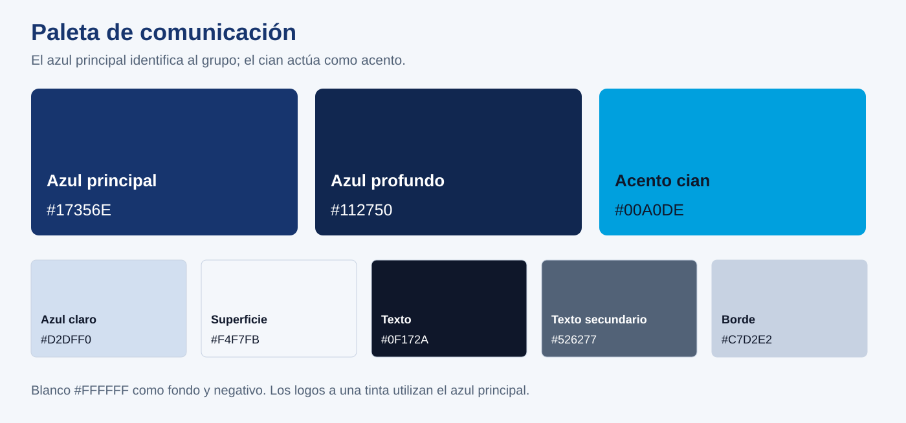

# Manual de comunicaciones AIS Group

**Versión 0.1 · 5 de octubre de 2026 · Borrador parcial**

Este documento reúne los recursos y criterios para las aplicaciones de comunicación. La paleta auxiliar se traslada aquí desde la primera propuesta del Manual de marca y queda pendiente de revisión. Los demás apartados se desarrollarán uno por uno según el [índice del proyecto](../../README.md#2-manual-de-comunicaciones-y-aplicaciones).

El [Manual de marca](../brand/manual-de-marca.md#4-color-corporativo) fija el azul principal **#17356E**, las variantes de logotipo y su reproducción a una tinta en ese mismo azul. Los colores de apoyo de este documento se destinan a las composiciones, fondos, textos y acentos; no crean variantes de color del logotipo.

## 1. Paleta de comunicación

### 1.1. Colores y funciones

| Token | Nombre | HEX | sRGB | Uso |
| --- | --- | --- | --- | --- |
| `color.primary` | Azul principal | `#17356E` | 23, 53, 110 | Identidad, logos, títulos y superficies principales |
| `color.deep` | Azul profundo | `#112750` | 17, 39, 80 | Apoyo oscuro y fondos con jerarquía secundaria |
| `color.accent` | Cian | `#00A0DE` | 0, 160, 222 | Acentos puntuales; continuidad con la paleta AIS anterior |
| `color.tint` | Azul claro | `#D2DFF0` | 210, 223, 240 | Fondos suaves y agrupación de información |
| `color.surface` | Superficie | `#F4F7FB` | 244, 247, 251 | Fondo editorial y zonas de descanso |
| `color.ink` | Texto principal | `#0F172A` | 15, 23, 42 | Texto sobre fondo claro |
| `color.muted` | Texto secundario | `#526277` | 82, 98, 119 | Pies y contenido secundario legible |
| `color.line` | Borde | `#C7D2E2` | 199, 210, 226 | Separadores decorativos; no garantiza contraste de controles |
| `color.white` | Blanco | `#FFFFFF` | 255, 255, 255 | Fondo y marca en negativo |

El azul principal se hereda del Manual de marca; este documento no lo redefine. El cian y el azul claro tienen antecedentes documentados. Los restantes valores de apoyo se proponen en esta versión. El cian es secundario: no sustituye al azul principal ni identifica una empresa distinta.

### 1.2. Criterios de aplicación

- Utilizar una base clara con azul para jerarquizar, o una base azul con contenido blanco.
- Reservar el cian para detalles, acentos y visualizaciones compatibles con el contraste requerido.
- Evitar un color corporativo diferente para cada compañía. Rosa, magenta, naranja, amarillo y gris dejan de funcionar como identificadores de marca en las nuevas aplicaciones de esta propuesta.
- Los colores funcionales de error, advertencia o éxito pertenecen al Design System y conservan su significado. No se sustituyen por azul cuando comunican un estado.
- Los colores propios de productos, fotografías y marcas de terceros no se recolorean para forzar la paleta.

### 1.3. Contraste

Valores calculados con la fórmula de luminancia relativa de WCAG para colores sRGB opacos:

| Combinación | Contraste | Criterio de uso |
| --- | ---: | --- |
| Blanco / azul principal | 11,86:1 | Apto para texto normal |
| Texto principal / superficie | 16,61:1 | Apto para texto normal |
| Texto secundario / blanco | 6,23:1 | Apto para texto normal |
| Azul principal / azul claro | 8,78:1 | Apto para texto normal |
| Cian / azul principal | 4,00:1 | No para texto normal; sí alcanza 3:1 para texto grande |
| Cian / blanco | 2,96:1 | No alcanza 3:1; reservar a decoración que no comunique información esencial |

Como referencia digital, WCAG AA exige al menos 4,5:1 para texto normal y 3:1 para texto grande, con las excepciones previstas por la norma. Texto grande equivale, en este criterio, a 18 pt o a 14 pt en negrita. No redondear 2,96:1 a 3:1 para considerarlo válido. El contraste de una pareja no acredita por sí solo la accesibilidad completa de una pieza.

Para texto normal sobre azul, utilizar blanco. Los logos siguen las variantes y reglas del Manual de marca; la reproducción a una tinta utiliza el azul principal.

### 1.4. Ejemplo de aplicación

La imagen ilustra la propuesta de paleta; no constituye una plantilla aprobada. Su desarrollo por soporte corresponde a los siguientes apartados del manual.

## 2. Recursos de esta propuesta

| Recurso | Ubicación |
| --- | --- |
| Azul principal y tipografía, definidos en marca | [Tokens de marca](../../assets/brand/palette/brand-v0.1.tokens.json) |
| Colores auxiliares en DTCG | [communications-v0.1.tokens.json](../../assets/communications/palette/communications-v0.1.tokens.json) |
| Variables CSS auxiliares | [communications-v0.1.css](../../assets/communications/palette/communications-v0.1.css) |
| Cálculos de contraste de la paleta | [contrast-v0.1.json](../../assets/communications/palette/contrast-v0.1.json) |
| Catálogo de comunicaciones | [catalog.json](../../assets/communications/catalog.json) |

Los tokens auxiliares complementan los de marca: al consumir ambos archivos, combinar sus grupos `color` conservando `color.primary` del archivo de marca. No sustituir un grupo completo por el otro. En CSS, cargar primero el archivo de marca y después el de comunicaciones; este último no redefine el azul principal.

Antecedentes y trazabilidad: [Fuentes y decisiones](../brand/fuentes-y-decisiones.md). Referencia para contraste: [W3C — WCAG 2.2](https://www.w3.org/WAI/WCAG22/Understanding/contrast-minimum.html).
