# Manual de comunicaciones y aplicaciones AIS Group

**Versión 0.4 · 5 de octubre de 2026 · Sistema hexagonal, relieve y volumen**

Este manual define cómo producir comunicaciones coherentes para AIS Group, AIS Vision Systems, AIS Vision Automation, AIS Scanology y Rosepetal. Está dirigido a marketing, comercial, diseño y a los agentes de IA que generan materiales para esos equipos.

La identidad se aplica a través de un mismo lenguaje: **azul compartido, información clara, evidencia visual y composiciones ordenadas**. El contenido y la marca emisora identifican la especialidad de cada compañía.

El [Manual de marca](../brand/manual-de-marca.md) establece los nombres, logotipos, protección, tamaños mínimos, tipografía y el azul principal **#17356E**. Este documento desarrolla la paleta auxiliar y sus aplicaciones. **Los logotipos a una tinta se reproducen en el azul principal**; el blanco corresponde al negativo.

Esta versión conserva los ejemplos por apartado y las infografías de retículas, color, documentos y comunicación. Rehace el apartado 3.4 con la dirección **«Del plano al volumen»**: ocho fondos hexagonales reutilizables y nueve nuevas láminas de construcción y aplicación. Las medidas y composiciones son decisiones operativas del proyecto, salvo las referencias externas identificadas. Las láminas son ejemplos de diseño; el apartado 10 distingue las plantillas editables pendientes. Los recursos nuevos mantienen estado `draft` hasta su revisión visual.

## Índice

1. [Voz y mensajes](#1-voz-y-mensajes)
2. [Paleta de comunicación](#2-paleta-de-comunicación)
3. [Lenguaje gráfico](#3-lenguaje-gráfico)
4. [Papelería y documentos](#4-papelería-y-documentos)
5. [Material comercial](#5-material-comercial)
6. [Campañas y comunicación digital](#6-campañas-y-comunicación-digital)
7. [Infografías y visualización](#7-infografías-y-visualización)
8. [Animaciones y audiovisual](#8-animaciones-y-audiovisual)
9. [Experiencias interactivas](#9-experiencias-interactivas)
10. [Plantillas, entrega y mantenimiento](#10-plantillas-entrega-y-mantenimiento)
11. [Recursos y referencias](#11-recursos-y-referencias)

## Cómo utilizar este manual

Antes de diseñar, definir **emisor, público, objetivo, mensaje, evidencia, formato y acción esperada**. Elegir una composición del apartado 3 y aplicar las reglas del soporte correspondiente. Revisar el resultado con la lista del apartado 10.

| Capa | Qué determina | Referencia |
| --- | --- | --- |
| Marca | Nombre, logo, color principal, familia tipográfica y protección | Manual de marca |
| Comunicaciones | Voz, paleta auxiliar, composición, plantillas y adaptación por canal | Este manual |
| Producto digital | Componentes reutilizables, estados, interacción y adaptadores de frameworks | Design System, en desarrollo |
| Pieza concreta | Público, campaña, contenido, idioma, dimensiones y destino | Brief de la pieza |

Un brief puede cambiar el contenido, el formato y la jerarquía. No puede introducir otro color para el logo, alterar sus formas ni convertir una afirmación sin evidencia en un dato comercial. Las ampliaciones de estilo se registran como nuevas propuestas del sistema.

## 1. Voz y mensajes

### 1.1. Voz común

La voz es **técnica, directa y cercana**. Explica qué hace una solución, dónde encaja y qué condiciones necesita. El lenguaje debe ser comprensible para una persona de operaciones sin perder precisión para un interlocutor técnico.

| Rasgo | Aplicación | Evitar |
| --- | --- | --- |
| Clara | Abrir con el problema o el resultado que interesa al lector | Empezar con una lista de tecnologías |
| Precisa | Nombrar proceso, objeto, unidad y condición de medida | «Máxima precisión» o «cero errores» sin evidencia |
| Segura | Describir capacidades demostrables y límites relevantes | Superlativos, garantías absolutas y promesas vagas |
| Cercana | Frases directas y vocabulario concreto | Exceso de siglas, solemnidad o tono paternalista |
| Útil | Terminar con un siguiente paso identificable | Llamadas a la acción genéricas sin destino |

En comunicación general en español se utiliza el trato de **tú**, preferentemente mediante construcciones directas: «Consulta la ficha», «Solicita una demostración». En ofertas y comunicaciones formales se adapta el tratamiento al cliente y se mantiene en toda la pieza. No alternar tú, usted y vosotros en un mismo documento.

**Ejemplo de aplicación.** «Te ayudamos a definir qué defectos debe detectar la inspección» es más útil que «Transformamos tu futuro con tecnología disruptiva». El primer mensaje nombra la tarea y permite continuar la conversación.

### 1.2. Estructura de mensaje

La secuencia preferente es **necesidad → solución → evidencia → siguiente paso**. No todas las piezas necesitan mostrar los cuatro elementos con el mismo peso.

| Elemento | Pregunta que resuelve | Regla |
| --- | --- | --- |
| Titular | ¿Por qué me interesa? | Una idea; preferentemente 6–12 palabras |
| Entradilla | ¿Qué propone esta pieza? | Una o dos frases con contexto |
| Desarrollo | ¿Cómo funciona y qué aporta? | Un argumento por bloque |
| Evidencia | ¿En qué se sustenta? | Imagen real, dato contextualizado, esquema o caso |
| Acción | ¿Qué hago después? | Una acción principal y un destino concreto |

Los límites de palabras son referencias editoriales, no motivos para recortar una condición técnica esencial.

**Ejemplo de titular:** «Inspección visual para controlar defectos en línea».

**Ejemplo de entradilla:** «Combina captura, análisis y criterios de aceptación en un proceso de inspección adaptado a tu producto».

**Ejemplo de acción:** «Solicitar una demostración». Estos textos ilustran el tono; cada pieza debe comprobar que describen la solución concreta que presenta.

**Ejemplo de aplicación.** En una invitación a demo: necesidad «Controlar defectos en línea»; solución «Conocer el flujo de captura y evaluación»; evidencia «Ver un ejemplo con sus condiciones»; acción «Solicitar una demostración».

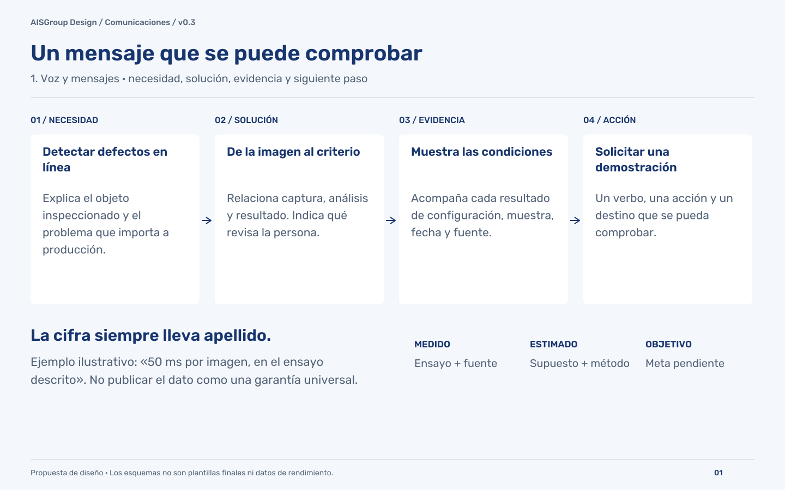

### 1.3. Adaptación por público

| Público | Prioridad del mensaje | Evidencia preferente |
| --- | --- | --- |
| Dirección | Impacto, alcance y condiciones de implantación | Caso con contexto y resultado verificable |
| Operaciones y calidad | Proceso, criterios de aceptación y trabajo diario | Flujo de inspección y ejemplo de resultado |
| Ingeniería e integración | Interfaces, arquitectura y restricciones | Diagrama técnico, ficha y requisitos |
| Compras | Alcance, entregables y condiciones | Propuesta estructurada y límites explícitos |
| Equipo interno | Decisión, responsable y fecha | Resumen operativo con enlaces a documentación |

La profundidad cambia con el público; las afirmaciones de capacidad deben mantenerse consistentes entre canales.

**Ejemplo de aplicación.** La misma ficha abre con alcance e implantación para dirección, con criterios de aceptación para calidad y con entradas/salidas e integración para ingeniería. Cambia el orden; no cambian las capacidades declaradas.

### 1.4. Evidencia y afirmaciones

Todo dato de rendimiento se acompaña de la información necesaria para interpretarlo: métrica, unidad, equipo o configuración, condiciones de ensayo y fecha o versión. Una cifra medida en laboratorio no se presenta como garantía de producción.

Separar **medido**, **estimado**, **objetivo** e **ilustrativo**. Una estimación debe indicar su supuesto. Un dato sintético debe identificarse en la propia figura. No inventar testimonios, clientes, certificaciones, porcentajes ni logotipos de partners.

| Redacción a evitar | Alternativa de trabajo |
| --- | --- |
| «Eliminamos todos los errores» | Describir los defectos que se evalúan y sus condiciones de validación |
| «IA de última generación» como argumento único | Explicar la tarea que realiza y el beneficio demostrado |
| «Hasta un 90 % de mejora» sin contexto | Identificar indicador, referencia de comparación y evidencia |
| «Certificado» sin alcance | Citar certificación, titular y alcance verificados |
| «Totalmente autónomo» en una tarea supervisada | Explicar qué automatiza el sistema y qué revisa una persona |

**Ejemplo de aplicación.** Un resultado «50 ms por imagen» se publica solo con la configuración, muestra, versión y método que lo sustentan. Sin esa evidencia, conservarlo como ejemplo o marcador pendiente, no como promesa.

### 1.5. Escritura, nombres e idiomas

Aplicar los nombres del Manual de marca. AIS Group firma las comunicaciones del conjunto; la compañía emisora firma las de su especialidad. «Part of AIS Group» puede aparecer como respaldo separado del logo.

- Utilizar mayúscula inicial en títulos, conservando siglas y nombres propios; evitar títulos enteros en mayúsculas.
- Desarrollar una sigla en su primera aparición cuando el público pueda desconocerla.
- Mantener los nombres comerciales de productos; no traducirlos por iniciativa de una campaña.
- En español, escribir decimales con coma y separar valor y unidad: «50 ms», «12 GB», «95 %». Utilizar espacio de no separación cuando el formato lo permita.
- Expresar fechas como «5 de octubre de 2026»; en archivos, `2026-10-05`. En convocatorias internacionales, indicar zona horaria.
- Preparar una versión completa por idioma. Las piezas bilingües se reservan a necesidades concretas, con bloques separados y jerarquía equivalente.
- Traducir el mensaje y las etiquetas de figuras; revisar desbordamientos, saltos y llamadas a la acción después de cada traducción.

**Ejemplo de aplicación.** Un título puede decir «Nueva solución de AIS Vision Systems» y un pie «Rosepetal · Part of AIS Group». Se conservan estas mayúsculas incluso dentro de una cabecera: no usar «Ais Vision Systems» ni «RosePetal».

## 2. Paleta de comunicación

### 2.1. Colores y funciones

El azul principal se hereda del Manual de marca. Los colores auxiliares sirven a la composición y no identifican compañías distintas.

| Token | Nombre | HEX | sRGB | Función |
| --- | --- | --- | --- | --- |
| `color.primary` | Azul principal | `#17356E` | 23, 53, 110 | Logo, títulos, acciones principales y superficies corporativas |
| `color.deep` | Azul profundo | `#112750` | 17, 39, 80 | Paneles oscuros y apoyo de jerarquía |
| `color.accent` | Cian | `#00A0DE` | 0, 160, 222 | Detalles, llamadas visuales y acentos |
| `color.tint` | Azul claro | `#D2DFF0` | 210, 223, 240 | Agrupación de información y fondos suaves |
| `color.surface` | Superficie | `#F4F7FB` | 244, 247, 251 | Fondo editorial y zonas de descanso |
| `color.ink` | Texto principal | `#0F172A` | 15, 23, 42 | Lectura sobre fondos claros |
| `color.muted` | Texto secundario | `#526277` | 82, 98, 119 | Pies, metadatos y contenido secundario |
| `color.line` | Borde | `#C7D2E2` | 199, 210, 226 | Separadores decorativos |
| `color.white` | Blanco | `#FFFFFF` | 255, 255, 255 | Fondo, texto sobre azul y logo en negativo |

El cian y el azul claro tienen antecedentes en la documentación aportada. Los demás valores auxiliares son decisiones de esta propuesta. El blanco actúa como soporte y negativo; el único color corporativo principal sigue siendo el azul.

**Ejemplo de aplicación.** En una ficha: título y logo en azul principal; tabla sobre blanco; panel explicativo en azul claro; cian limitado a una pequeña llamada visual. No usar cian para el texto pequeño del pie.

### 2.2. Equilibrio y combinaciones

Para una pieza clara, tomar como referencia **70 % de blanco o superficie, 25 % de azul y 5 % de acento**. En una pieza oscura: **70 % de azul, 25 % de áreas claras o contenido blanco y hasta 5 % de cian**. Son pautas de equilibrio de las áreas gráficas, excluyendo fotografías, no cuotas que deban calcularse por píxel.

| Combinación | Uso preferente | Aplicación |
| --- | --- | --- |
| Blanco + azul principal | Documentos, ofertas, fichas y lectura extensa | Títulos y firmas azules; cuerpo en texto principal |
| Azul principal + blanco | Portadas, aperturas, banners y cierres | Mensaje breve, logo en negativo y pocos elementos |
| Superficie + azul + azul claro | Explicación técnica e infografías | Grupos y paneles con jerarquía visible |
| Azul + cian puntual | Campañas y animaciones | Una línea, marcador o detalle; no un segundo logo |

No mezclar varios colores de acento en una misma pieza. No recuperar magenta, rosa, naranja o amarillo como identificadores de las compañías. Las fotografías, productos y marcas de terceros conservan sus colores propios.

Los colores funcionales de error, éxito o advertencia pertenecen al Design System. Cuando aparezcan en una captura o un gráfico, conservar su significado y acompañarlos de texto o símbolos. No convertir un error en azul para ajustarlo a la marca.

**Ejemplo de aplicación.** Una portada azul puede abrir un folleto y dar paso a interiores claros. La fotografía conserva sus colores; no se contabiliza como un nuevo acento corporativo.

### 2.3. Contraste y legibilidad

Ratios calculados para colores sRGB opacos:

| Combinación | Contraste | Aplicación |
| --- | ---: | --- |
| Blanco / azul principal | 11,86:1 | Texto normal y firmas en negativo |
| Texto principal / superficie | 16,61:1 | Lectura extensa |
| Texto secundario / blanco | 6,23:1 | Pies y metadatos |
| Azul principal / azul claro | 8,78:1 | Títulos y contenido sobre paneles |
| Cian / azul principal | 4,00:1 | Acentos y texto grande; no texto normal |
| Cian / blanco | 2,96:1 | Decoración sin información esencial |

Para texto digital, la referencia WCAG AA es **4,5:1 en texto normal y 3:1 en texto grande**; este último corresponde a 18 pt o 14 pt en negrita. No redondear 2,96:1 a 3:1. Los elementos gráficos necesarios para comprender información y los indicadores visuales necesarios para identificar controles deben cumplir el contraste aplicable, generalmente 3:1 frente a colores adyacentes, con las excepciones de la norma. Véanse [contraste de texto](https://www.w3.org/WAI/WCAG22/Understanding/contrast-minimum.html) y [contraste no textual](https://www.w3.org/WAI/WCAG22/Understanding/non-text-contrast.html).

El borde claro es decorativo: no utilizarlo como único límite de un campo interactivo. En enlaces sobre blanco, usar azul principal y subrayado; en botones principales, azul con texto blanco. Un ratio correcto no sustituye la revisión de tamaño, fondo real, foco y lectura.

**Ejemplo de aplicación.** Un enlace sobre blanco usa azul principal y subrayado. El cian sobre blanco, con 2,96:1, se reserva a una línea decorativa; no sustituye ese enlace ni el borde esencial de un campo.

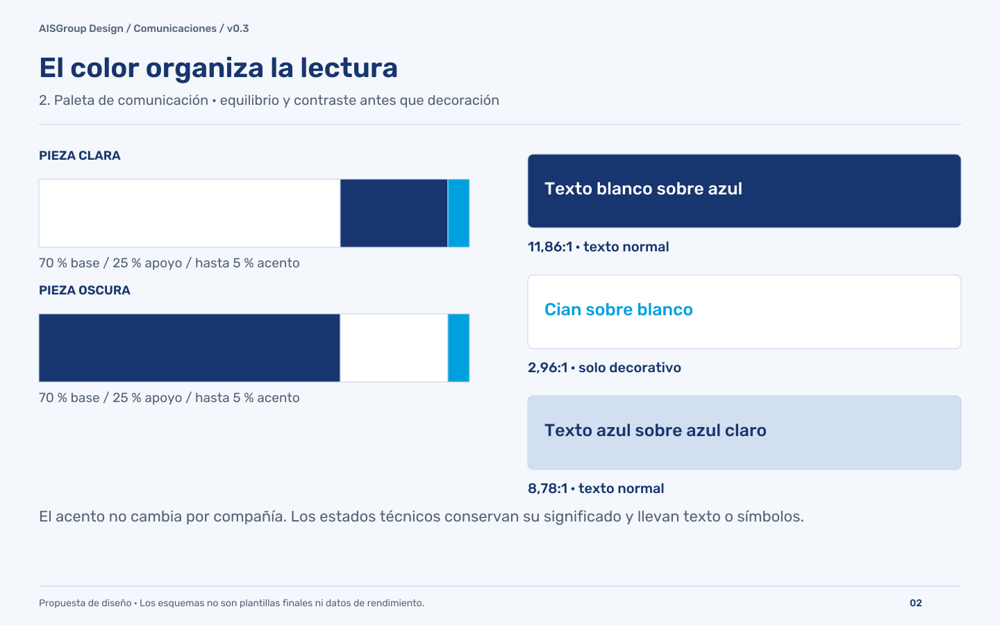

### 2.4. Impresión y una tinta

Para avanzar con una referencia concreta, se establece la siguiente **propuesta provisional de reproducción del azul principal**, pendiente de elegir y validar en un muestrario físico:

| Sistema | Referencia de trabajo | Alcance |
| --- | --- | --- |
| Digital | **HEX #17356E · sRGB 23 / 53 / 110** | Se conserva como definición digital vigente |
| Tinta directa | **PANTONE 534 C** | Candidato inicial de la biblioteca Solid Coated, para papel estucado |
| Cuatricromía | **C 100 % · M 82 % · Y 36 % · K 25 %** | Receta CMYK propuesta por el proyecto para maquetas y primera prueba; cobertura total 243 % |

**Estas referencias están asociadas por decisión de diseño, no por una equivalencia colorimétrica exacta.** El CMYK es una receta provisional del proyecto, no un valor certificado por Pantone ni una conversión ICC del HEX. No tiene todavía perfil de salida asignado. Se registra fuera de los tokens sRGB en [primary-blue-v0.1.json](../../assets/brand/print/primary-blue-v0.1.json), para que los agentes no sustituyan automáticamente un sistema por otro.

El sufijo **C** identifica el soporte estucado de la referencia Pantone. Para papel no estucado se escogerá la muestra adecuada; no se presupone que cambiar C por U conserve el mismo resultado. Al preparar el arte final, registrar papel, acabado, sistema de impresión y perfil acordado. Comparar el candidato Pantone y la primera prueba CMYK con la dirección de azul deseada; ajustar y aprobar entonces los valores finales. La visualización en pantalla es orientativa.

En una pieza a una tinta, **la tinta es azul**: utilizar PANTONE 534 C como candidato para la prueba o una tinta azul formulada con el proveedor. Los logotipos se reproducen al **100 % de esa tinta**; los elementos auxiliares pueden utilizar tramas si el proceso las reproduce correctamente. El componente K de una mezcla CMYK no convierte esa mezcla en una variante negra del logo.

La [ficha oficial de Pantone 534 C](https://www.pantone.com/color-finder/534-c) identifica la referencia. [Pantone Color Bridge](https://www.pantone.com/products/graphics/color-bridge-guide-set-coated-uncoated) permite comparar tinta directa y simulación de cuatricromía sobre soportes distintos; los valores de esta propuesta no se presentan como una transcripción de esa guía.

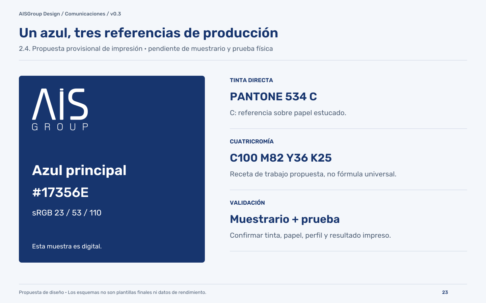

## 3. Lenguaje gráfico

La composición común se construye con retícula, jerarquía y un vocabulario gráfico derivado de las webs del grupo. Los apartados siguientes muestran su construcción y aplicación.

### 3.1. Retícula y espaciado

Alinear logo, titular, texto y acción con una misma estructura. Utilizar una retícula de **12 columnas en formatos horizontales amplios, 6 en composiciones verticales y 4 en móvil**. No es necesario ocupar todas las columnas: una imagen puede usar seis y el texto otras seis.

| Contexto | Margen de partida | Separación entre columnas | Espaciado interno |
| --- | --- | --- | --- |
| A4 vertical | 18 mm | 6 mm | Múltiplos de 2 mm; bloques separados al menos 6 mm |
| Presentación 16:9 | 5 % del ancho en laterales | Según la retícula de la plantilla | Módulos de 8 unidades sobre lienzo de 1920 × 1080 |
| Pieza social | 6 % del lado corto | Según composición | Múltiplos de 8 px sobre el original de 1080 px |
| Web editorial y demos | 24–48 px; 16–24 px en móvil | 24 px; 16 px en móvil | 4, 8, 12, 16, 24, 32, 48, 64 px |
| Email | 24 px en escritorio; 16 px en móvil | 16–24 px | Separaciones de 8, 16, 24 y 32 px |

Estas medidas no sustituyen el área de protección del logo ni las zonas reservadas por cada canal. En composiciones compactas, simplificar antes de reducir el texto. Evitar centrar párrafos largos y justificar textos con huecos irregulares.

#### Construcción de tres originales

La retícula debe cerrar numéricamente: **ancho útil = ancho del soporte − 2 × margen**; **ancho de columna = (ancho útil − calles × separación) / columnas**. Los originales siguientes fijan un punto de partida reproducible, sin convertir todas las medidas en un único tamaño universal.

| Original | Margen por lado | Columnas | Calle | Ancho de columna | Ejemplo de ocupación |
| --- | ---: | ---: | ---: | ---: | --- |
| Lienzo de campaña horizontal 1440 px | 96 px | 12 | 24 px | 82 px | Texto 6 + imagen 6; tres módulos de 4 |
| A4, ancho 210 mm | 18 mm | 6 | 6 mm | 24 mm | Texto a 6; dos bloques de 3 |
| Móvil, ancho 390 px | 24 px | 4 | 16 px | 73,5 px | Titular, imagen y acción a 4, apilados |

En el horizontal, 6 columnas más sus 5 calles suman **612 px**; entre los dos bloques queda una calle de 24 px. En A4, 3 columnas y sus 2 calles suman **84 mm**. En móvil, el bloque completo mide **342 px**. No redondear cada columna móvil por separado: dejar que la retícula distribuya las fracciones.

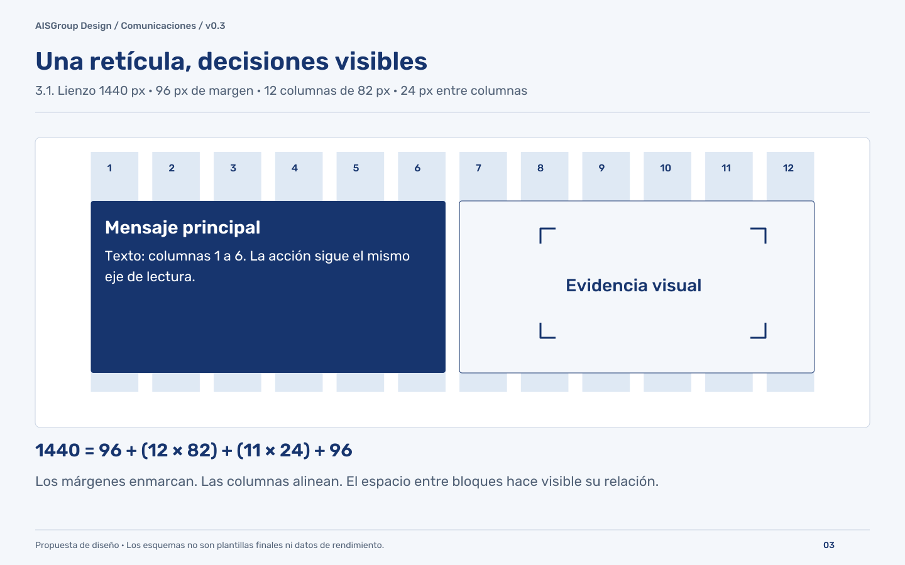

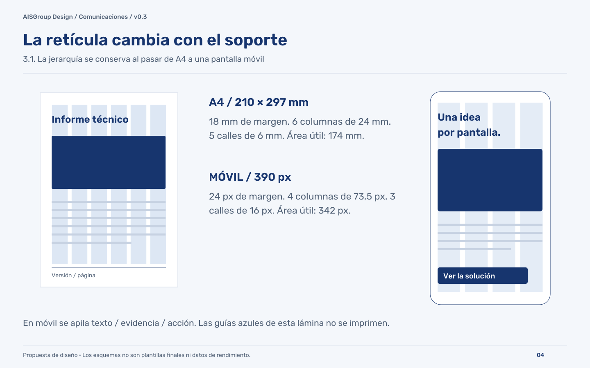

#### Relación entre los espacios

Usar una separación menor entre elementos relacionados y mayor entre ideas: **8 px** entre etiqueta y dato, **16 px** entre elementos de un pequeño bloque, **24–32 px** entre título y cuerpo o imagen, y **48–64 px** entre secciones, ajustando al tamaño del soporte. En impresión, trabajar con la escala de múltiplos de 2 mm; no convertir píxeles a milímetros por una equivalencia mecánica.

**Ejemplo:** una ficha alinea logo, título, fotografía y tabla con el margen de 18 mm. La tabla no sigue el borde de una imagen que sobresale. En móvil, una composición 6 + 6 se apila; conserva el orden de lectura, no las dimensiones del escritorio. Las retículas azules de las láminas son guías explicativas y se retiran de la pieza final.

### 3.2. Jerarquía tipográfica

Utilizar **Rubik 400, 500 y 600**, conforme al Manual de marca. Reservar 600 a títulos y énfasis; 500 a subtítulos y etiquetas; 400 a lectura. Arial es la alternativa de compatibilidad cuando Rubik no está disponible. En correo, utilizar una pila con Arial y fuente genérica y revisar la sustitución.

| Soporte | Titular | Subtítulo | Cuerpo | Nota o pie |
| --- | --- | --- | --- | --- |
| A4 | 26–32 pt / 1,1 | 15–18 pt / 1,25 | 11 pt / 1,45 | 9 pt / 1,35 |
| Presentación | 32–40 pt / 1,1 | 24–28 pt / 1,2 | 20–24 pt / 1,3 | 14–16 pt / 1,3 |
| Web editorial | 40–56 px; 30–36 px en móvil / 1,1 | 24–32 px / 1,2 | 16–18 px / 1,5 | 14 px / 1,4 |
| Email | 28–32 px / 1,15 | 20–24 px / 1,25 | 16 px / 1,5 | 14 px / 1,4 |
| Imagen de 1080 px de ancho | 64–88 px / 1,05 | 40–48 px / 1,2 | 36–42 px / 1,25 | 30–34 px / 1,3 |

Tras la barra se indica el interlineado como multiplicador. Son escalas de partida; se valida el tamaño final de lectura. En pantalla de sala, si un pie requiere menos de 14 pt, trasladar el detalle a las notas o a un documento de apoyo.

Limitar la composición a tres niveles principales de texto. Mantener líneas de aproximadamente 45–75 caracteres en lectura extensa. No condensar ni deformar letras para encajar un titular. Evitar mayúsculas extensas, contornos de texto y sombras decorativas.

**Ejemplo de aplicación.** En una página web editorial: Rubik 600 a 48/52,8 px para el título; 500 a 28/33,6 px para subtítulos; 400 a 18/27 px para cuerpo. Si el título ocupa demasiado, editar el texto o darle otra línea.

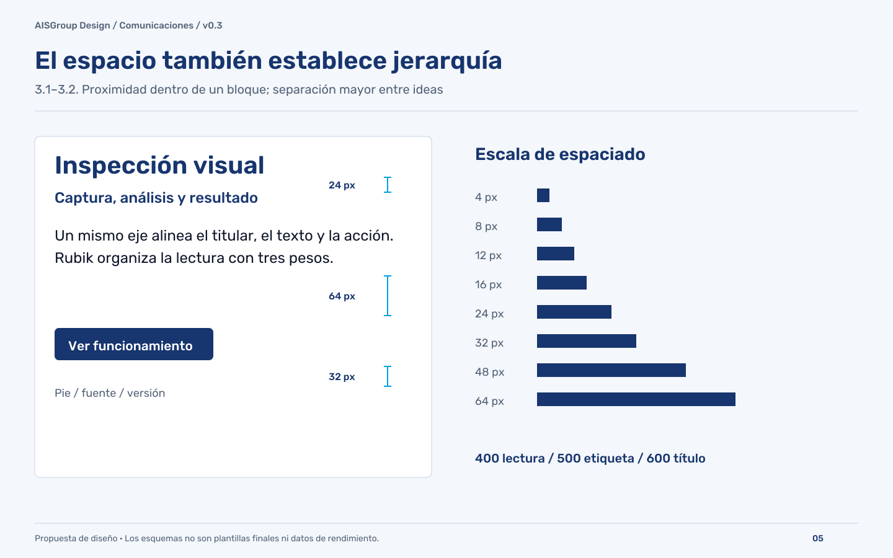

### 3.3. Composiciones base

| Composición | Estructura | Cuándo utilizarla |
| --- | --- | --- |
| Clara | Fondo blanco o superficie; firma arriba; titular azul; evidencia y texto; cierre | Documentación, fichas, propuestas y contenidos de lectura |
| Oscura | Fondo azul; logo blanco; titular breve; una evidencia o detalle; acción clara | Portadas, aperturas, banners y cierres |
| Técnica | Fondo claro; bloques alineados; encabezados azules; diagramas y datos con leyenda | Procesos, comparativas, informes e infografías |

Una campaña puede alternarlas manteniendo posición de firma, estilos de título y recursos. No cambiar de retícula, tratamiento de imagen y acento en cada página. La forma de la tarjeta o del panel se mantiene dentro de una pieza.

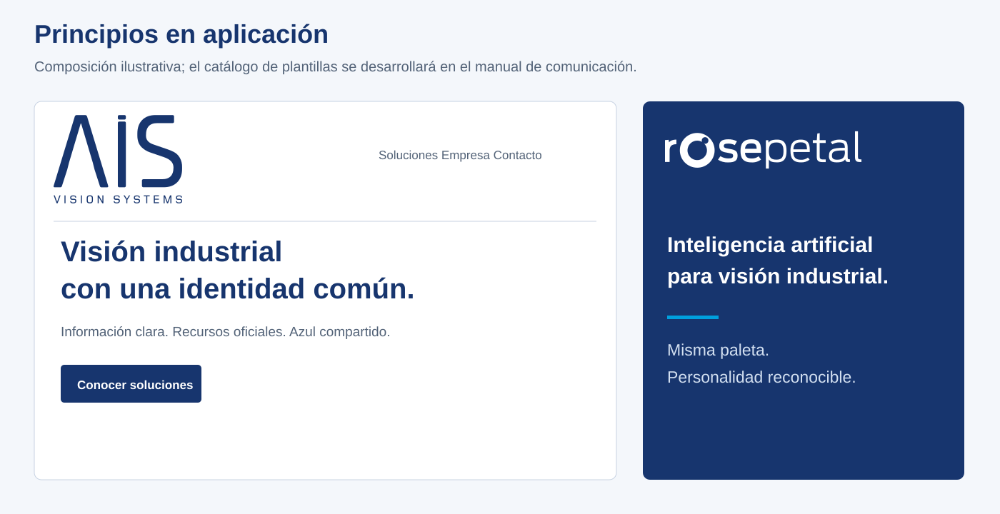

**Ejemplo de aplicación.** Un caso puede abrir con portada oscura, desarrollar problema y solución en composición clara y cerrar resultados en técnica. Mantiene la posición de firma, los estilos de título y el mismo motivo a lo largo de la serie.

### 3.4. Elementos, tramas y fondos

#### 3.4.1. Idea de diseño: del plano al volumen

**El hexágono es la forma de origen del sistema.** Recupera un recurso reconocible de AIS Vision Systems y lo desarrolla mediante repetición, escala, luz y profundidad. La misma cara hexagonal puede ser una línea, una celda en relieve o un prisma protagonista. Esta continuidad permite variar las piezas sin inventar un lenguaje distinto en cada una.

«Del plano al volumen» es una dirección de diseño interna, no un nuevo eslogan. Conecta la imagen plana y los objetos físicos con los que trabaja la visión industrial. No implica que todas las soluciones midan en 3D: la geometría de fondo es una ilustración abstracta, nunca evidencia de una capacidad o de un resultado.

La trama histórica es el antecedente; los recursos de esta versión son **geometría original**, con orientación, proporciones y materialidad comunes. Las tres expresiones sirven a todas las compañías. El emisor se identifica mediante su logotipo y contenido, no mediante un motivo o color exclusivo.

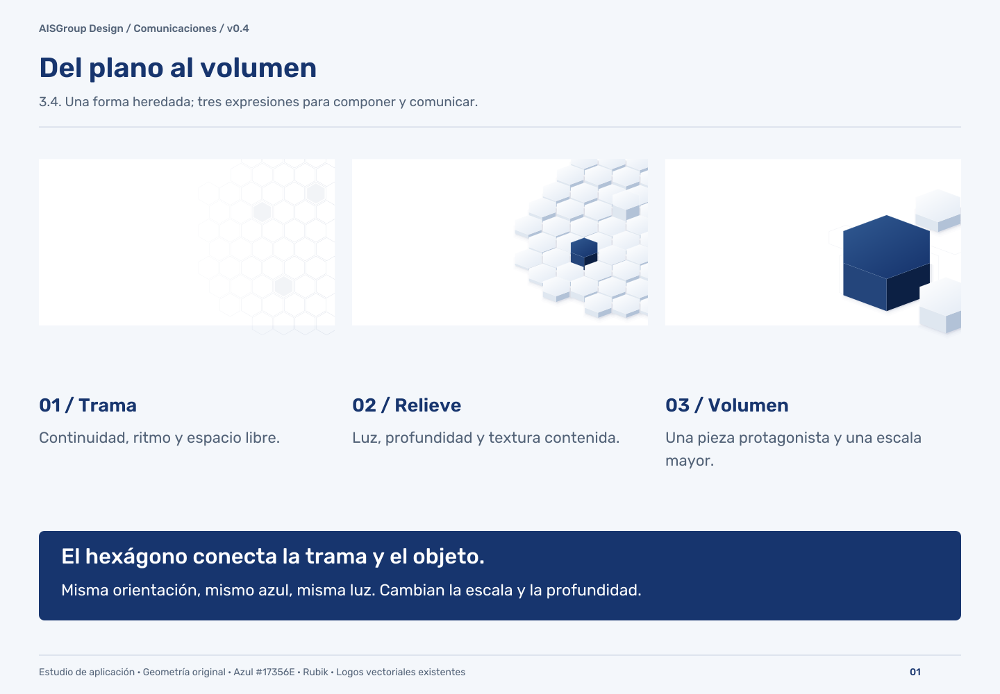

La revisión parte de las webs del grupo y de referencias de diseño consultadas el 5 de octubre de 2026:

| Referencia | Recurso observado | Decisión para este sistema |
| --- | --- | --- |
| AIS Vision Systems y AIS Scanology | Antecedentes hexagonales en tramas, contornos y máscaras | Recuperar la geometría como elemento reconocible; fijar una construcción común |
| AIS Group, AIS Vision Automation y Rosepetal | Azul, composiciones ordenadas, equipos y contenido de inspección | Mantener las zonas de lectura y el protagonismo de la evidencia real |
| [Spaces — Fold7](https://fold7design.com/work/spaces) | Evolución de un hexágono existente hacia una forma cúbica y recursos de composición | Desarrollar la forma heredada en varias escalas y aplicaciones |
| [Journey — Holmes Studio](https://www.holmes-studio.com/projects/journey) | Un hexágono aparente que se revela como cubo en movimiento | Relacionar plano y volumen; aquí se adopta el prisma de cara hexagonal para conservar esa cara durante la extrusión |
| [Kempner Institute — Opus](https://kempnerinstitute.harvard.edu/app/uploads/2024/08/Kempner-Institute-Brand-Book-visual-identity.final_.pdf#page=12) | Tramas hexagonales a escalas micro y macro con reglas de uso | Separar textura de fondo y forma protagonista; controlar frecuencia y densidad |
| [Zentiva — ART*WORKS](https://artjustworks.com/hexagon-structure) | Trama sobre vidrio y objetos acústicos tridimensionales | Explorar profundidad y materialidad a partir de la misma geometría |
| [CENTIDE — Microbio](https://www.microbio.tv/proyectos/branding-centide/) | Retícula hexagonal e isométrica extendida a iconografía | Mantener una lógica geométrica común entre recursos; sin forzar todos los iconos a ser hexágonos |

El [registro de referencias y decisiones v0.4](referencias-visuales-v0.4.md) detalla qué se toma de cada proyecto. No se incorporan sus imágenes, símbolos ni archivos a los fondos suministrados.

#### 3.4.2. Construcción: forma, retícula, luz y material

El módulo es un **hexágono regular con un vértice arriba**. Si su radio circunscrito es `r`, su lado también mide `r`, su ancho es `√3 × r`, su alto es `2 × r` y sus ángulos interiores son de 120°. Los centros de una retícula contigua avanzan `√3 × r` en horizontal y `1,5 × r` entre filas, con medio paso horizontal de desplazamiento en filas alternas. Una junta pequeña puede separar las caras sin cambiar esa lógica.

La retícula editorial de columnas del apartado 3.1 sigue organizando texto, márgenes y paneles. La retícula hexagonal construye la ilustración; no obliga a colocar párrafos o botones dentro de hexágonos.

| Parámetro | Regla de trabajo | Efecto buscado |
| --- | --- | --- |
| Orientación | Un vértice arriba en la trama plana; mantenerla dentro de la serie | Continuidad reconocible |
| Relieve | Proyección ortográfica; en los SVG, la coordenada vertical del plano se multiplica por 0,64 | Profundidad estable y sin puntos de fuga contradictorios |
| Altura de celdas | Relieve habitual de 0,12–0,40 r; elevaciones puntuales hasta 0,85 r | Ondulación contenida, con pocos puntos de énfasis |
| Pieza protagonista | Prisma de mayor escala; altura aproximada de 0,4–0,7 r | Una forma que se reconoce en cabeceras y portadas |
| Iluminación | Luz amplia desde arriba a la izquierda; caras inferiores más oscuras | Volumen legible, sin destellos ni neón |
| Material | Mate o satinado suave; juntas y aristas finas | Precisión industrial y sobriedad |
| Color | Azul principal, blanco y valores tonales de luz/sombra | Una misma identidad; sin asignar colores a cada empresa |

Los valores tonales de las caras son **sombreado de la ilustración**. No crean nuevos colores de marca, estados de interfaz ni alternativas para recolorear el logo. No aplicar efectos 3D, brillos ni degradados al logotipo. Una pieza a una tinta utiliza la trama lineal en azul; el relieve se sustituye por esa versión cuando la impresión no pueda reproducirlo de forma fiable.

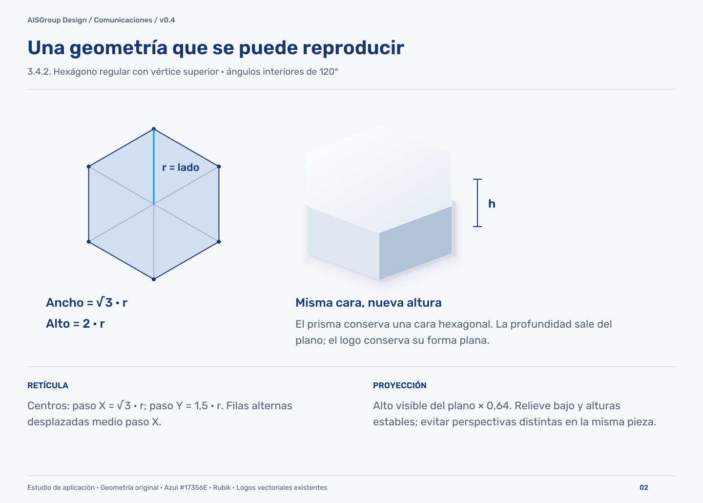

#### 3.4.3. Tres tratamientos y ocho recursos

| Tratamiento | Construcción y carácter | Usos preferentes |
| --- | --- | --- |
| **Trama / `hex-weave`** | Hexágonos de contorno fino, densidad progresiva hacia el borde y unas pocas celdas de relleno tenue | Pies, separadores, comunicaciones técnicas y fondos de poco peso visual |
| **Relieve / `hex-relief`** | Celdas con junta, altura baja y luz coherente; algunas elevaciones puntuales | Portadas de documentos, paneles de apertura y presentaciones |
| **Volumen / `hex-volume`** | Un prisma grande y dos piezas secundarias; contornos del plano como apoyo | Cabeceras web, banners, portadas y apertura de vídeo |

Cada tratamiento dispone de una variante clara y otra azul en **1600 × 900**. El volumen tiene además dos composiciones verticales de **900 × 1200**. Son ocho SVG autocontenidos, con fondo sólido incorporado. Las sombras y caras se construyen con geometría vectorial; no requieren texturas externas, scripts ni filtros de desenfoque.

La trama plana utiliza el azul sobre blanco o un tinte claro sobre azul, con opacidad aproximada del 6,5–23 % según la columna. Es decorativa. El relieve y el volumen tienen sus propios valores tonales: no reducir la opacidad del archivo completo porque también incluye el fondo. La lámina siguiente reproduce los fondos con sus valores reales.

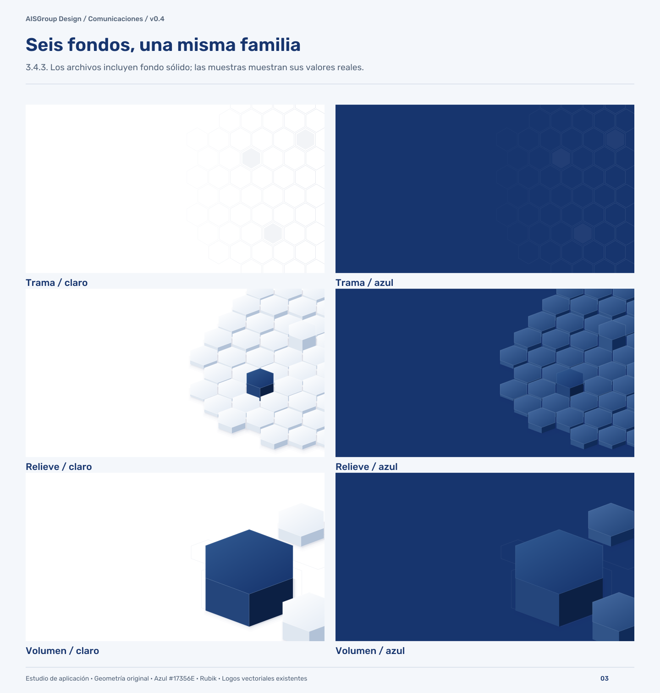

#### 3.4.4. Componer con el sistema

En horizontal, reservar el área **x = 96–800, y = 64–820** para firma, mensaje y acción. La geometría ocupa la zona derecha y conserva una separación adicional respecto al texto. Ese espacio es un límite de composición, no una obligación de llenarlo. La protección del logotipo se aplica también dentro de esta zona.

| Pieza | Tratamiento elegido | Composición concreta |
| --- | --- | --- |
| Cabecera de AIS Vision Systems | Volumen sobre azul | Logo plano blanco arriba; titular en dos líneas y acción a la izquierda; prisma a la derecha |
| Presentación de Rosepetal | Relieve sobre azul en portada | Titular y subtítulo sobre zona uniforme; celdas solo en el lado visual; interiores claros para capturas y explicación |
| Ficha de AIS Scanology | Trama clara localizada en el pie | Logo y títulos azules; contenido, tablas y condiciones sobre blanco; textura al final de página |
| Comunicación de AIS Group | Trama o volumen, según formato | Firma del grupo y una idea principal; las marcas secundarias mantienen su protección |
| Caso de AIS Vision Automation | Trama clara o fondo plano | Fotografía real protagonista; el recurso geométrico se reserva a cabecera o cierre |

**Ejemplo de cabecera.** «La precisión toma forma.» ilustra la jerarquía del diseño. Es un texto de muestra, no un eslogan aprobado. El prisma acompaña al mensaje; una sección posterior debe mostrar el equipo o la solución real.

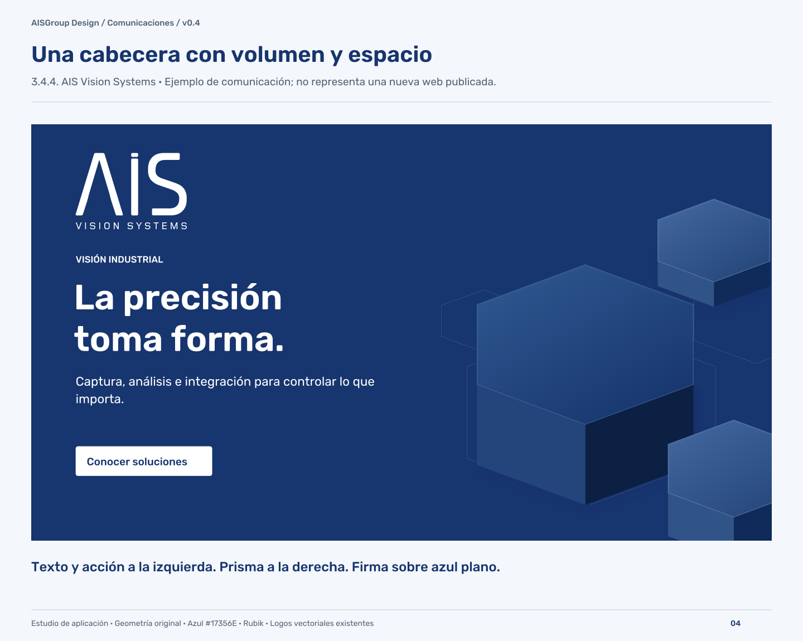

**Ejemplo de documentos.** La portada de Rosepetal puede tener relieve; las páginas de resultados permanecen claras. La ficha de AIS Scanology concentra la trama en el pie y conserva los criterios técnicos en texto editable.

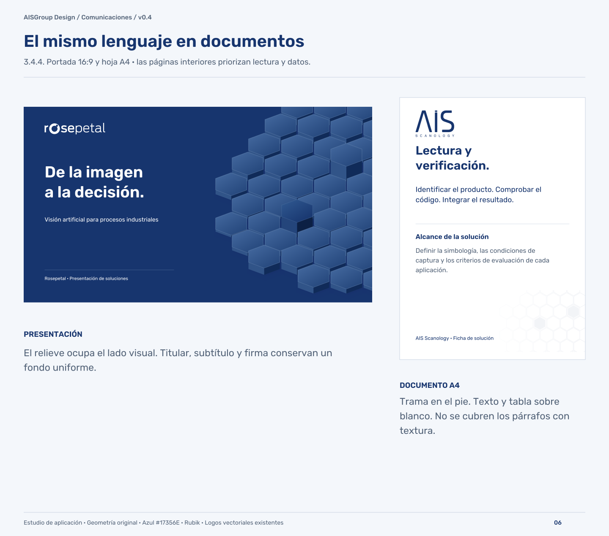

#### 3.4.5. Adaptación, escala y recorte

Escalar siempre de forma proporcional. Recortar piezas desde el borde mantiene la sensación de continuidad; estirar la geometría modifica sus proporciones. No cambiar por separado la perspectiva de una celda ni introducir una segunda dirección de luz.

En móvil se utiliza la composición vertical: contenido en **x = 64–836, y = 54–780** y volumen en la zona inferior. El texto sigue siendo HTML o texto editable. Si crece por traducción o accesibilidad, aumentar la altura del bloque y desplazar el recurso hacia abajo; no superponerlo al contenido ni reducir la tipografía para encajarlo.

Una superficie usa **un tratamiento dominante**. Dentro de una campaña, trama, relieve y volumen pueden alternarse manteniendo azul, firma, orientación y jerarquía. En una página de lectura extensa o en una tabla, el fondo plano es suficiente.

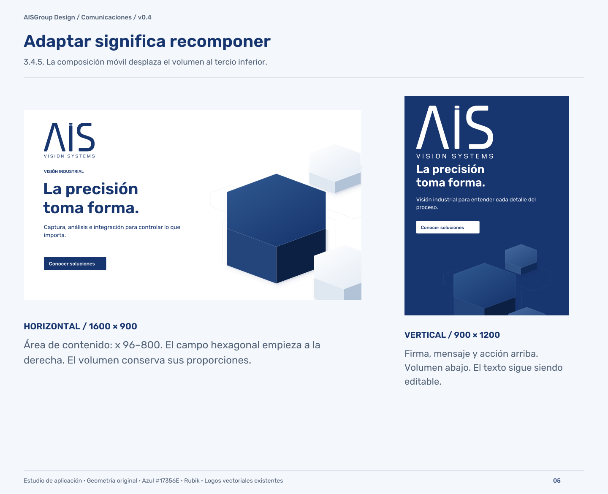

#### 3.4.6. Límites de uso y legibilidad

- Mantener firma, párrafos, datos y controles sobre una zona uniforme. Revisar el contraste en el soporte final.
- Concentrar la textura en el borde o en un área visual. No cubrir todos los fondos de todas las páginas con panales.
- Conservar las formas planas del logo. El hexágono es un elemento de comunicación; no se añade al logotipo ni lo sustituye.
- Utilizar las caras y sombras de una misma familia. Evitar neón, cromados, arcoíris, halos y materiales distintos dentro de la serie.
- Mantener las fotografías y capturas como evidencia independiente. El volumen abstracto no representa un sensor, un producto ni un resultado medido.
- En gráficos cuantitativos, usar las reglas del apartado 7.4: el 3D decorativo no debe alterar la lectura de magnitudes.

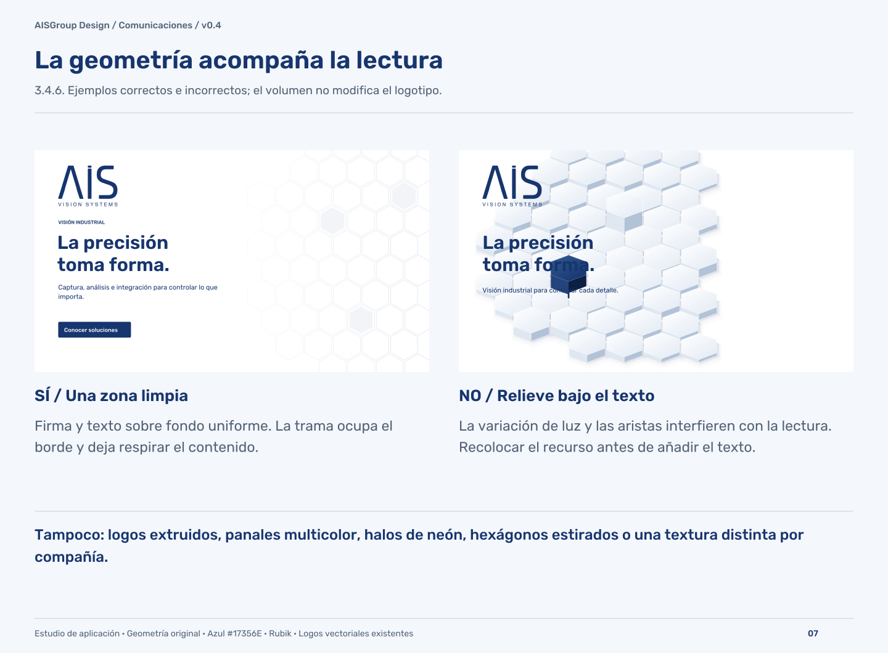

#### 3.4.7. Movimiento: el plano adquiere altura

La transición preferente eleva la geometría desde el plano hasta su volumen final. Como punto de partida: **900 ms en total**, una sola vez, con aceleración y frenado suaves. El titular, el logo y la acción permanecen estables. La animación termina en la misma composición que el SVG estático.

La lámina muestra una propuesta de movimiento; los archivos SVG entregados son estáticos. Si se implementa en web o vídeo, respetar la geometría, las alturas y la dirección de luz. No deformar el hexágono para simular la perspectiva. En `prefers-reduced-motion: reduce`, mostrar directamente el estado final. Evitar bucles detrás del texto, parpadeos y barridos de escáner.

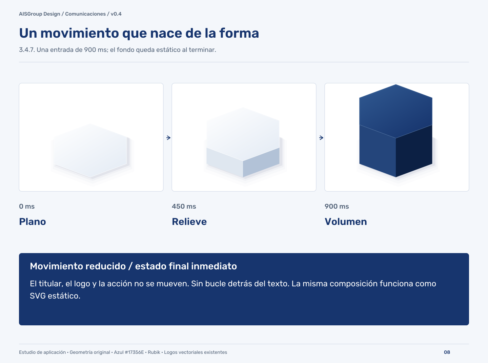

#### 3.4.8. Archivos, integración y sustitución de versiones

| Recurso | Claro | Azul |
| --- | --- | --- |
| Trama 1600 × 900 | [hex-weave-light.svg](../../assets/communications/backgrounds/draft/v0.4/hex-weave-light.svg) | [hex-weave-dark.svg](../../assets/communications/backgrounds/draft/v0.4/hex-weave-dark.svg) |
| Relieve 1600 × 900 | [hex-relief-light.svg](../../assets/communications/backgrounds/draft/v0.4/hex-relief-light.svg) | [hex-relief-dark.svg](../../assets/communications/backgrounds/draft/v0.4/hex-relief-dark.svg) |
| Volumen 1600 × 900 | [hex-volume-light.svg](../../assets/communications/backgrounds/draft/v0.4/hex-volume-light.svg) | [hex-volume-dark.svg](../../assets/communications/backgrounds/draft/v0.4/hex-volume-dark.svg) |
| Volumen 900 × 1200 | [hex-volume-light-mobile.svg](../../assets/communications/backgrounds/draft/v0.4/hex-volume-light-mobile.svg) | [hex-volume-dark-mobile.svg](../../assets/communications/backgrounds/draft/v0.4/hex-volume-dark-mobile.svg) |

Consultar la [definición estructurada v0.4](../../assets/communications/graphic-system-v0.4.json) para geometría, zonas de contenido, familias y reglas, y la [galería de revisión](../../assets/communications/previews/v0.4/index.html) para comparar las aplicaciones en navegador. La galería es una vista estática del repositorio; GitHub muestra su código y puede abrirse al descargar el conjunto.

En web, el fondo es decorativo (`alt=""`, o `aria-hidden="true"` y `pointer-events: none` si se integra como SVG inline). El contenido permanece accesible y editable por separado. No incrustar el titular en el fondo reutilizable. En presentaciones y documentos, insertar SVG conservando proporciones; exportar a PNG al tamaño requerido cuando la aplicación de destino no los admita. En email, conservar un fondo plano como alternativa y comprobar el resultado sin imágenes.

**Esta versión sustituye la dirección gráfica v0.3.** Los fondos de captura, muestreo, rutas y bandas quedan retirados para nuevas composiciones; sus archivos se conservan para trazabilidad. Los marcos de región de interés, conectores y códigos reales siguen siendo válidos como información técnica cuando expliquen contenido real. No funcionan como motivos de fondo alternativos.

La instrucción de recuperar los hexágonos sustituye la propuesta anterior que los descartaba. Las variantes v0.4 mantienen estado `draft` para la revisión del diseño; publicar el manual no equivale a aprobar automáticamente cada pieza. Los nombres exactos, el azul digital, los logotipos planos y la propuesta provisional PANTONE 534 C / CMYK 100–82–36–25 se conservan.

### 3.5. Imágenes, fotografía y capturas

La fotografía debe ayudar a entender una instalación, producto, proceso o equipo humano. Priorizar escenas reales y encuadres con una función clara: contexto, detalle técnico o resultado. Ajustar exposición, recorte y balance de blancos sin cambiar el significado de la escena.

En una pieza, mantener un tratamiento fotográfico consistente. Dejar una zona limpia para el texto o colocarlo en un panel separado; una veladura no garantiza por sí sola contraste suficiente sobre toda la imagen.

Las capturas muestran una versión identificada del producto. Recortar datos ajenos a la explicación, ocultar información confidencial y conservar los detalles necesarios para comprender la interfaz. No dibujar resultados ficticios sobre una captura real. Usar ampliaciones y llamadas numeradas cuando la captura completa pierda legibilidad.

Las ilustraciones generadas con IA pueden representar conceptos. Si pueden confundirse con un equipo, una instalación o un resultado real, indicarlo junto a la imagen. Los logos, mediciones, capturas de producto y testimonios deben proceder de recursos y evidencias verificables.

**Ejemplo de aplicación.** La imagen de galletas publicada por Rosepetal ya contiene una anotación roja de segmentación. Se conserva como parte de la evidencia visual; no se vuelve azul para ajustarla a la paleta ni se añade un porcentaje ficticio.

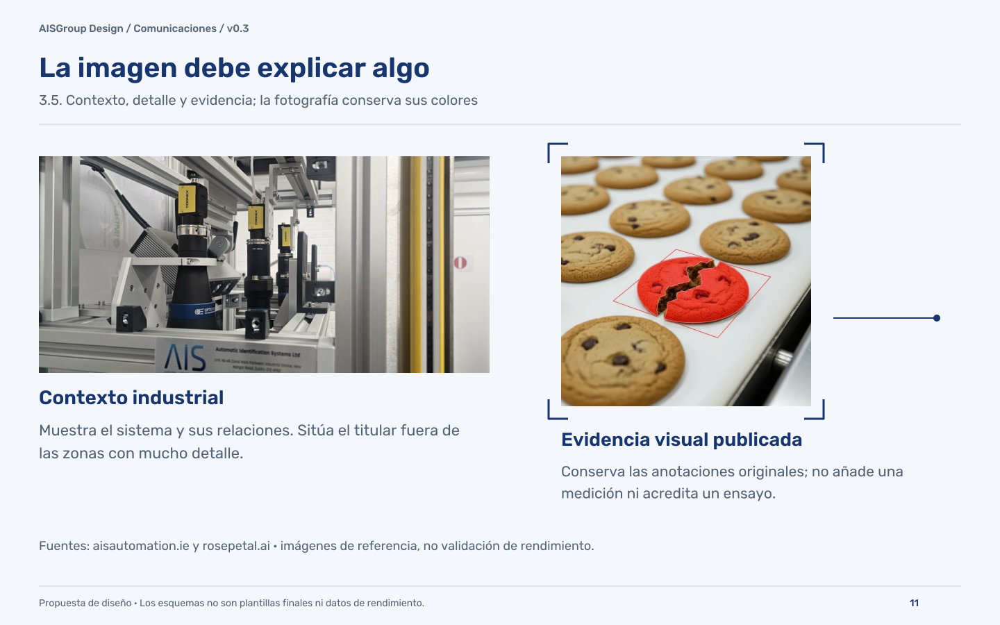

### 3.6. Iconografía y formas

Seleccionar una única familia de iconos por colección de plantillas y registrar su licencia antes de incorporarla. Esta versión define el estilo: **contorno, caja base de 24 × 24, trazo nominal de 2 unidades, extremos consistentes y sin volumen**. No mezcla iconos rellenos y de línea con igual función.

Usar azul principal sobre claro y blanco sobre azul. Los iconos informativos se acompañan de etiqueta; los puramente decorativos no sustituyen palabras. En diagramas, una misma forma representa el mismo tipo de elemento.

Paneles digitales: radio base de 8 px y borde de 1 px cuando sea útil. En documentos impresos, radio de 2 mm como referencia. Reservar formas circulares para marcadores, pasos o imágenes que lo necesiten. Las sombras no son necesarias para la jerarquía editorial.

**Ejemplo de aplicación.** Captura, proceso, registro y acción se dibujan con la misma caja y trazo. El icono de acción lleva texto «Ver resultado»; el marco de captura decorativo no parece un botón.

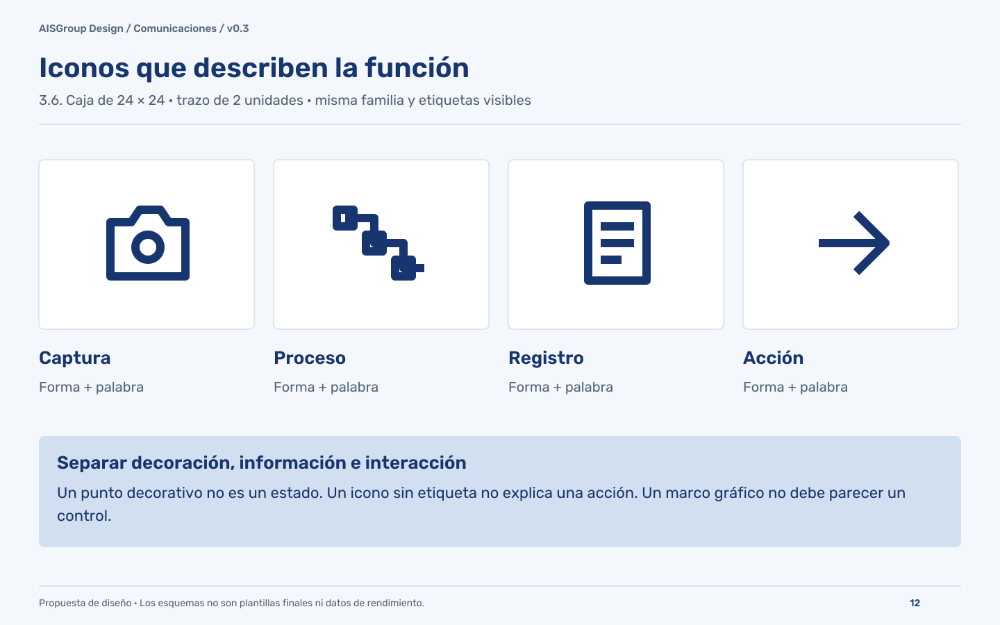

## 4. Papelería y documentos

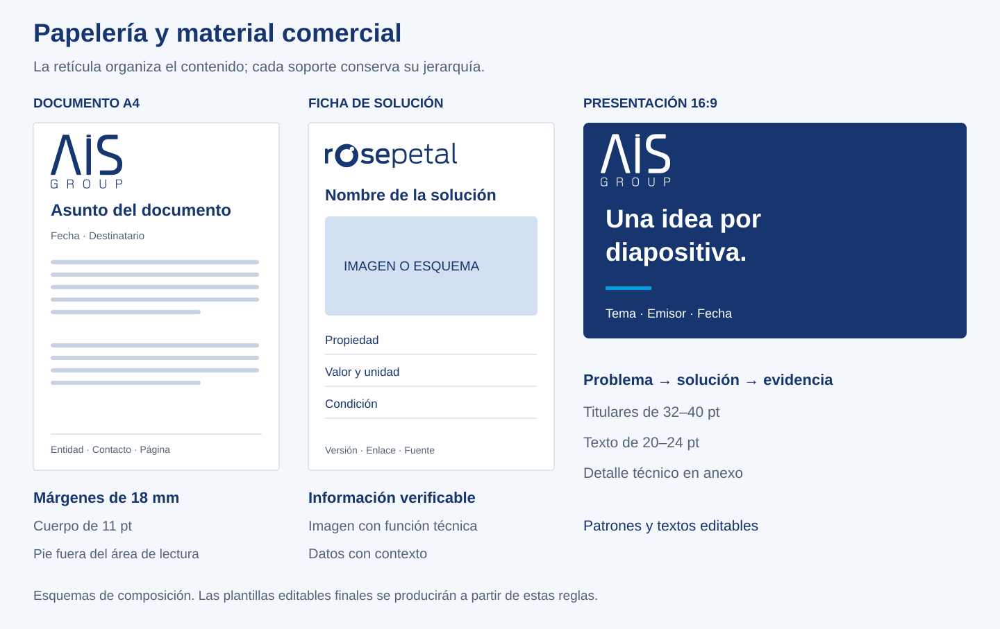

### 4.1. Hoja corporativa y carta

Formato base **A4 vertical, 210 × 297 mm**, márgenes de 18 mm. Situar la marca emisora en la cabecera, respetando sus mínimos del Manual de marca; no asignar el mismo ancho a todos los logos si eso vuelve ilegible su descriptor.

Orden de contenido: destinatario, lugar y fecha, asunto, cuerpo, despedida y firma. Usar un título de asunto claro y párrafos breves. El pie contiene razón social y datos de contacto validados; no copiar los de otra empresa del grupo.

Reservar una franja inferior de unos 15 mm dentro del área útil para los datos recurrentes. El cuerpo no invade el pie. En páginas interiores, reducir la cabecera a una firma discreta o al nombre del documento; no repetir una portada completa.

**Ejemplo de aplicación.** Una carta a un cliente comienza con su destinatario y asunto, seguido de un cuerpo de 11 pt. Logo, asunto y párrafos parten del mismo margen; el pie conserva sus 15 mm de zona propia.

### 4.2. Informes y documentación técnica

| Zona | Contenido |
| --- | --- |
| Portada | Marca, título, cliente o proyecto cuando corresponda, fecha, versión y clasificación de uso |
| Apertura | Objeto, alcance y resumen de resultados o decisiones |
| Cuerpo | Secciones numeradas, tablas, figuras y fuentes junto a los datos |
| Cabecera interior | Título abreviado o capítulo |
| Pie interior | Marca o nombre de entidad, versión y número de página |
| Cierre | Conclusiones, siguientes pasos, contacto y anexos |

Utilizar estilos de título reales, tablas editables y pies de figura. Repetir cabeceras de tablas largas; evitar separar una etiqueta de su valor al cambiar de página. No usar una captura como sustituto de una tabla editable.

Para lectura en pantalla, exportar PDF con texto seleccionable, marcadores cuando proceda y orden de lectura revisado. Mantener además el original editable. La exportación a PDF no garantiza por sí sola accesibilidad documental.

**Ejemplo de aplicación.** Un informe de ensayo incluye objeto, configuración, muestra, método, resultados y conclusiones. Una figura lleva «Figura 2 · Configuración del ensayo · versión y fecha» junto a su explicación.

### 4.3. Tarjetas y piezas breves de contacto

Referencia de tarjeta: **85 × 55 mm**, con adaptación al proveedor. Anverso: logo y nombre; reverso: cargo y datos de contacto, o una sola cara cuando el contenido lo permita. Usar fondo blanco o azul principal.

Mantener el texto esencial al menos a 4 mm del corte; el sangrado se confirma con imprenta. Un QR es secundario: acompañarlo de una URL legible, comprobar destino y lectura en una prueba al tamaño real y conservar su zona libre. No recolorear sus módulos con un acento de bajo contraste ni superponer el logo.

**Ejemplo de aplicación.** En la tarjeta de 85 × 55 mm, dejar un área segura interior de al menos 77 × 47 mm al aplicar 4 mm por lado. El contacto sigue siendo legible aunque no se incluya QR.

### 4.4. Firma de correo personal

Bloque compacto, alineado a la izquierda: **nombre, cargo, compañía, teléfono, email y web**, seguido del respaldo del grupo cuando corresponda. Evitar repetir campos que no aportan información.

Usar texto HTML seleccionable con una pila de fuentes de sistema. Incluir un único logo, exportado a PNG a partir del SVG oficial, en una zona con fondo definido que preserve contraste. No enviar toda la firma como una imagen.

La variante de firma se prueba en los clientes de correo utilizados por el equipo, con imágenes bloqueadas y modo oscuro. No incluir citas personales, banners animados ni cinco logos en cada mensaje. Una campaña temporal, si se necesita, ocupa un bloque separado y tiene fecha de retirada.

**Ejemplo de aplicación.** Nombre y apellidos / cargo / AIS Scanology / teléfono / correo / web, con un solo logo. «Part of AIS Group» aparece como línea de respaldo independiente. Los datos se rellenan desde la ficha de persona.

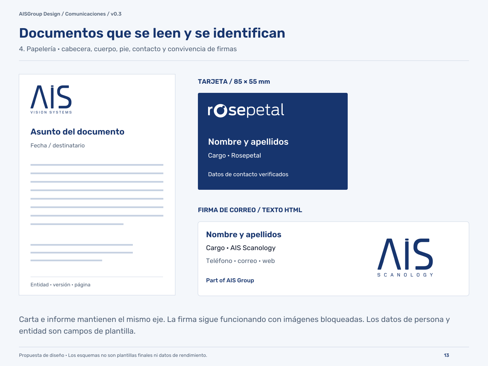

## 5. Material comercial

### 5.1. Presentaciones

Formato base **16:9**. Diseñar con patrones de diapositiva y estilos editables; no convertir cada diapositiva en una imagen plana.

| Tipo de diapositiva | Contenido y composición |
| --- | --- |
| Portada | Marca emisora, tema, destinatario si procede y fecha; una imagen o fondo oscuro |
| Problema | Una necesidad concreta y su contexto |
| Solución | Una idea central, esquema o imagen con etiquetas |
| Proceso | 3–5 pasos; dividir si se necesita más detalle |
| Evidencia | Dato o caso con fuente y condiciones |
| Comparativa | Criterios homogéneos y unidades comunes |
| Cierre | Mensaje final, acción principal y contacto |

Utilizar un titular que exprese la idea de la diapositiva. Mantener aproximadamente 30–50 palabras de cuerpo en una presentación oral, excluyendo etiquetas de gráficos; mover el detalle a notas o anexo. Una presentación para lectura puede ser más densa, pero debe identificarse como tal.

No mostrar automáticamente los cinco logos en todas las diapositivas. Una presentación de grupo abre con AIS Group y presenta las compañías en una página específica. Las transiciones siguen las reglas del apartado 8.

**Ejemplo de aplicación.** Una diapositiva de proceso presenta «Captura → evaluación → resultado», cuando esas etapas son reales. Las condiciones y detalles de cada paso van en notas o anexo si impiden leerla durante la exposición.

### 5.2. Propuesta comercial

La propuesta permite entender **qué se entrega, qué necesita el cliente y cómo se acepta**. Su estructura base es:

1. Portada y resumen de la necesidad.
2. Solución propuesta y alcance.
3. Entregables, integración y responsabilidades de cada parte.
4. Plan, hitos y dependencias.
5. Criterios de validación o aceptación.
6. Importe, vigencia y condiciones comerciales verificadas.
7. Exclusiones, supuestos y siguientes pasos.

Distinguir funcionalidades disponibles, desarrollos propuestos y opciones. Las tablas de precio llevan moneda y tratamiento fiscal conforme a la oferta validada; no rellenar importes o condiciones por analogía con otro cliente.

Las condiciones y anexos mantienen legibilidad equivalente al resto del documento. Marcar claramente la versión para evitar que una actualización parcial conviva con precios o plazos anteriores.

**Ejemplo de aplicación.** La tabla de alcance separa «Incluido», «Opción» y «A cargo del cliente». Una cámara adicional no aparece simultáneamente como incluida en el esquema y opcional en la oferta.

### 5.3. Brochures y folletos

Formato inicial recomendado para el catálogo del grupo: **A4 vertical de 4 páginas** o **A4 de 2 páginas** para una solución concreta. El número de páginas se adapta al proceso de impresión.

| Página de un folleto de 4 páginas | Función |
| --- | --- |
| 1 | Necesidad, propuesta de valor y firma |
| 2 | Solución y funcionamiento, con imagen o esquema |
| 3 | Aplicaciones, capacidades y evidencia contextualizada |
| 4 | Integración, siguiente paso y contacto |

No usar una página como un inventario de todos los productos. Agrupar la oferta según la tarea del cliente. Para un tríptico, diseñar sobre el plano de plegado del proveedor; los paneles no se obtienen dividiendo el ancho en tres sin revisar su cierre.

**Ejemplo de aplicación.** Folleto de cuatro páginas: 1 problema y firma; 2 funcionamiento; 3 aplicaciones y evidencia; 4 integración y contacto. La ruta de proceso puede continuar entre páginas sin atravesar texto.

### 5.4. Ficha de producto o solución

A4 de una o dos páginas. Primera mitad: nombre, descripción breve e imagen real o esquema identificado. Segunda mitad: aplicaciones, características, requisitos e integración.

La tabla técnica contiene **propiedad, valor, unidad y condición**, añadiendo versión cuando afecte al dato. Distinguir valores típicos, máximos, configurables y opcionales. Incluir fecha de revisión, referencia de documento y enlace a información ampliada.

**Ejemplo de aplicación.** Fila de ficha: «Tiempo de proceso | [valor] ms | [configuración y ensayo]». La unidad tiene su lugar y la condición acompaña al dato; no se completa con un valor típico de otro sistema.

### 5.5. Caso de éxito

Estructura: contexto del cliente, problema, solución aplicada, resultado medido y aprendizaje. Presentar el resultado con periodo, base de comparación y alcance. Si el cliente no puede identificarse, utilizar una descripción sectorial coherente y retirar datos que permitan reconocerlo.

Las citas requieren texto y atribución validados. El permiso para describir un proyecto no se presume extensible a publicar imágenes de la instalación o el logo del cliente. Hasta disponer de esos materiales, trabajar con marcadores explícitos en la versión de revisión.

**Ejemplo de aplicación.** El caso se presenta como «Situación inicial / intervención / resultado medido / condiciones». Si no se puede publicar el nombre del cliente, el título identifica sector y problema sin insinuar un testimonio autorizado.

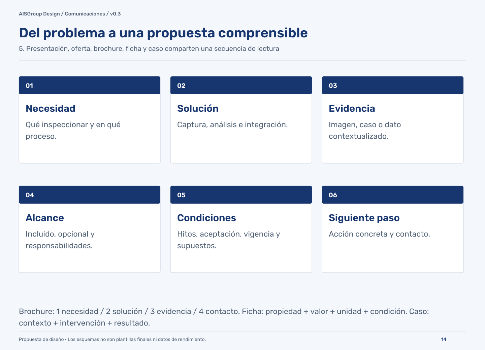

## 6. Campañas y comunicación digital

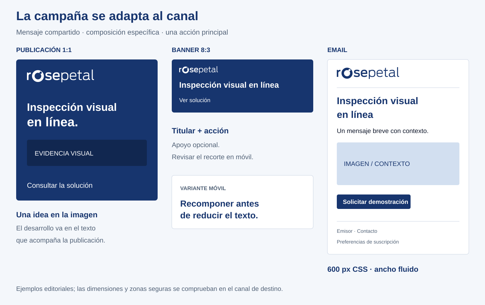

### 6.1. Sistema de campaña

Una campaña tiene un mensaje central, una evidencia, una llamada a la acción y una familia visual. Sus adaptaciones comparten tratamiento de imagen, posición relativa de firma y estilo de títulos. Cada formato recompone el contenido; no se limita a recortar un original horizontal.

Preparar un paquete con texto largo, texto breve, titular, imagen, acción y URL de destino. Registrar campaña, idioma, marca y fecha. Si se usan enlaces de seguimiento, documentar la convención y comprobar el destino final.

**Ejemplo de aplicación.** Una campaña sobre inspección en línea usa el mismo titular y destino en post, banner y email. La imagen cambia de recorte para mantener visible el objeto; el mensaje no promete prestaciones distintas por canal.

### 6.2. Formatos de trabajo

Estos tamaños son **originales de producción del proyecto**, no especificaciones universales de redes sociales. Antes de publicar, comprobar dimensiones, recortes, zonas superpuestas, peso y duración en el destino concreto.

| Original | Dimensión de partida | Aplicación |
| --- | --- | --- |
| Cuadrado | 1080 × 1080 px, 1:1 | Publicación general y tarjetas |
| Vertical | 1080 × 1350 px, 4:5 | Contenido editorial para feed |
| Vertical completo | 1080 × 1920 px, 9:16 | Vídeo o pieza vertical |
| Horizontal | 1920 × 1080 px, 16:9 | Vídeo, portada y pantalla |
| Banner ancho | 1600 × 600 px, 8:3 | Cabecera editorial o módulo web |
| Cabecera de email | 1200 × 480 px de archivo | Visual mostrado hasta 600 × 240 px CSS |

Mantener contenido esencial dentro del margen de partida y ampliar la zona libre según la interfaz del canal. En 9:16, colocar firma, subtítulos y acción después de comprobar las superposiciones reales del reproductor.

**Ejemplo de aplicación.** Del original 1:1 al 8:3 se retira el apoyo secundario y se recompone el título en una línea cuando cabe. No se aplasta el cuadrado ni se recorta la firma.

### 6.3. Publicaciones y carruseles

Una publicación estática comunica una idea. Preferir titular, evidencia y firma; trasladar el desarrollo al texto que la acompaña. Una cifra necesita unidad y contexto, también si aparece como gran recurso visual.

Carrusel de referencia: **5–8 páginas**, con portada, contexto, explicación, evidencia y cierre. Mantener numeración y una progresión visible. Cada página debe poder leerse sin recordar todo el texto anterior. El cierre concreta la acción y el destino.

Escribir texto alternativo cuando el canal lo permita. Si una figura contiene información que no cabe en una descripción breve, ofrecerla también como texto o en una página enlazada. No depender exclusivamente de texto incrustado en la imagen.

**Ejemplo de aplicación.** Carrusel de cinco páginas: pregunta inicial, contexto, tres pasos del proceso, evidencia y acción. La página de evidencia conserva la fuente; no la esconde únicamente en la última página.

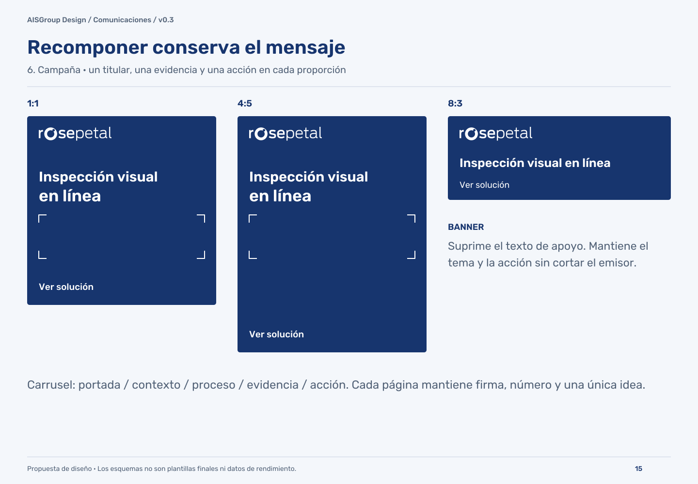

### 6.4. Banners y cabeceras

Utilizar **un titular, un apoyo opcional y una acción**. Priorizar el punto focal de la fotografía y reservar una zona limpia para texto. Si el banner se estrecha, eliminar primero el apoyo; no reducir indefinidamente el titular.

En banners web, mantener título y acción como HTML siempre que sea posible. La imagen aporta el fondo o la evidencia. La variante móvil debe poder usar otro recorte. Comprobar que el logo, una cara o el producto no quedan cortados en los tamaños de destino.

**Ejemplo de aplicación.** El banner de escritorio coloca titular a la izquierda y evidencia a la derecha. En móvil se apilan y se simplifica el fondo; el titular sigue siendo texto HTML en la web.

### 6.5. Mailing y newsletters

Estructura base: remitente reconocible, asunto, preencabezado, cabecera con firma, titular, desarrollo, evidencia, acción principal y pie. Asunto de referencia: 35–55 caracteres; preencabezado: 60–100. Su visualización varía por cliente, por lo que se revisa la vista previa.

Adoptar **600 px CSS de ancho máximo** como base de esta propuesta, con ancho fluido hasta el disponible. Usar una columna principal; los bloques de dos columnas deben apilarse en móvil. El texto de cuerpo parte de 16 px, con enlaces identificables y botones de al menos 44 px de alto como criterio interno.

| Módulo | Regla |
| --- | --- |
| Cabecera | Un logo de la marca emisora; navegación solo si aporta una función real |
| Apertura | Titular, dos o tres líneas y acción cuando proceda |
| Contenido | Bloques breves con una jerarquía repetida |
| Imagen | PNG o JPEG según contenido; dimensiones declaradas y texto alternativo |
| Acción | Texto que describe el siguiente paso; destino comprobado |
| Pie | Emisor y datos de contacto; preferencias y baja para suscripciones según el sistema de envío |

Construir el email con una estructura HTML y estilos compatibles con los clientes objetivo. No depender de JavaScript, vídeo incrustado, fuentes externas o SVG como único soporte de información. La información principal y la acción deben funcionar con imágenes desactivadas.

Presupuesto interno inicial: **hasta 1 MB de imágenes por email**, con cabecera preferentemente inferior a 250 KB. Es un objetivo de ligereza, no un límite normativo del canal. Si se supera, optimizar primero; no deteriorar una captura hasta hacerla ilegible.

Comprobar escritorio y móvil, modo claro y oscuro, sustitución tipográfica, imágenes bloqueadas, enlaces y pie. Realizar envíos de prueba en los clientes reales del equipo. Las [referencias de diseño de Mailchimp](https://templates.mailchimp.com/design/) y de [texto alternativo](https://mailchimp.com/help/add-alt-text-to-images/) orientan la implementación, sin imponer una plataforma de envío.

**Ejemplo de aplicación.** Asunto: «Conoce el flujo de inspección en línea». Preencabezado: «Una demostración de captura, análisis y resultado». La acción «Solicitar demostración» funciona aunque no cargue la cabecera gráfica.

### 6.6. Landings de campaña

Secuencia base: propuesta de valor, problema, solución, evidencia, preguntas relevantes y acción. Mantener coherencia entre anuncio, titular de llegada y formulario. Pedir únicamente los datos necesarios para el siguiente paso definido.

La landing utiliza los componentes del Design System cuando estén disponibles. Este manual determina su jerarquía editorial, contenido y tratamiento visual; no crea una segunda biblioteca de componentes por campaña.

**Ejemplo de aplicación.** La landing de esa invitación abre con el mismo tema, muestra funcionamiento y evidencia, y termina en un formulario breve. La confirmación explica cuál será el siguiente contacto.

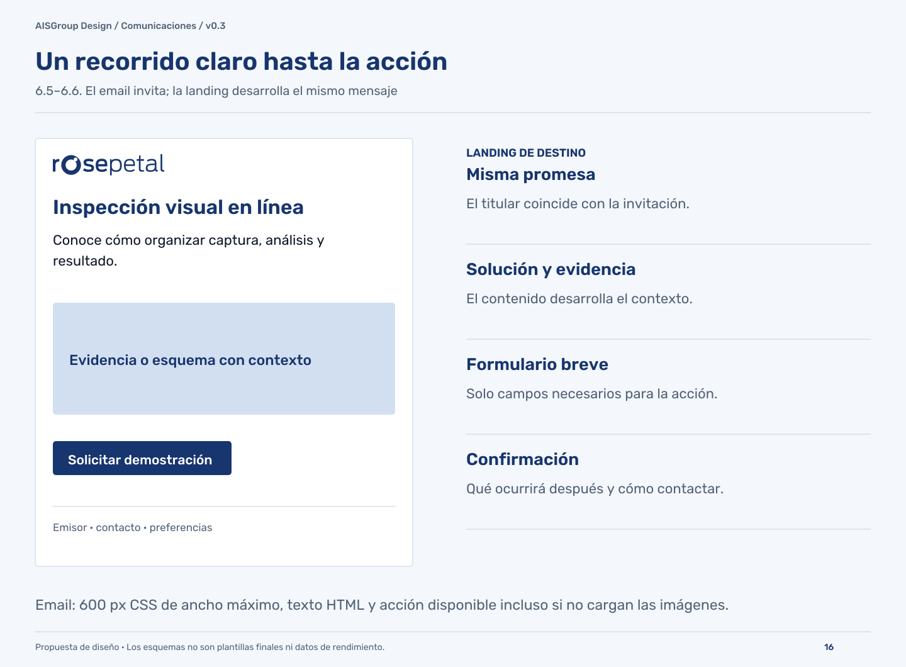

## 7. Infografías y visualización

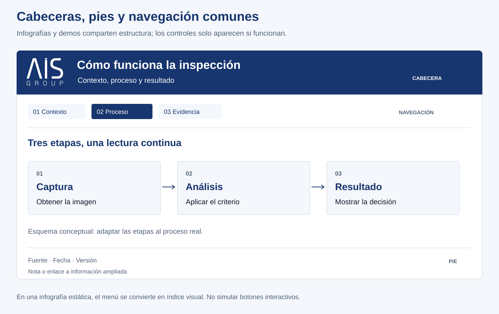

### 7.1. Estructura común

Toda infografía identifica **qué explica, quién la emite, cómo se lee y de dónde procede la información**.

| Zona | Contenido | Proporción orientativa |
| --- | --- | --- |
| Cabecera | Firma, título y contexto breve | 15–20 % de la altura |
| Navegación o índice | Pasos o secciones, si ayudan a comprender el recorrido | Solo el espacio necesario |
| Cuerpo | Diagrama, gráfico o comparación principal | Área predominante |
| Pie | Fuente, fecha o versión, notas y enlace | 8–12 % de la altura |

Las proporciones se ajustan al contenido. En una pieza estática, un índice es una guía visual: no dibujar controles que aparenten funcionar. En una pieza interactiva, la navegación sigue el apartado 9.

**Ejemplo de aplicación.** Una lámina titulada «Cómo se organiza la inspección» contiene una entradilla, tres etapas etiquetadas y un pie con fuente, versión y fecha. Se entiende fuera del documento que la contiene.

### 7.2. Cabeceras, pies y menús editoriales

Cabecera clara: fondo blanco, logo azul y título azul. Cabecera oscura: fondo azul, logo y título blancos. En ambos casos, alinear firma y contenido con la retícula. Mantener el área de protección del logo y separar emisor de título.

En series, repetir la misma cabecera y pie; variar solo título, número, fecha y contenido. El pie no es un lugar para reducir la letra de fuentes esenciales hasta hacerla ilegible.

El menú editorial utiliza etiquetas breves, preferentemente 3–5 secciones. El estado actual se distingue por texto, peso o indicador, además del color. Para formatos pequeños, sustituir una fila larga por un índice vertical.

**Ejemplo de aplicación.** En una serie de cinco infografías, la cabecera mantiene emisor y tema; el pie cambia a «2/5», «3/5», etc. El índice de una imagen estática se presenta como etiquetas, no como botones.

### 7.3. Diagramas y procesos

Elegir una dirección dominante: izquierda a derecha para secuencias breves y arriba abajo para procesos largos. Usar flechas con un significado consistente. Distinguir entrada, transformación y resultado mediante etiquetas y formas, sin depender solo del color.

Mantener un máximo orientativo de cinco pasos por fila. Si hay más, dividir en fases o cambiar la orientación. Etiquetar las bifurcaciones y marcar el inicio y final cuando no sean evidentes. No introducir líneas cruzadas para aprovechar un hueco.

Los diagramas de arquitectura muestran relaciones reales. No añadir conexiones, equipos o automatismos para que la ilustración parezca más completa. Una arquitectura conceptual debe identificarse como tal.

**Ejemplo de aplicación.** Si un resultado requiere revisión humana, el diagrama añade la bifurcación etiquetada «Revisar» y su destino. No une captura y rechazo directo si esa automatización no existe.

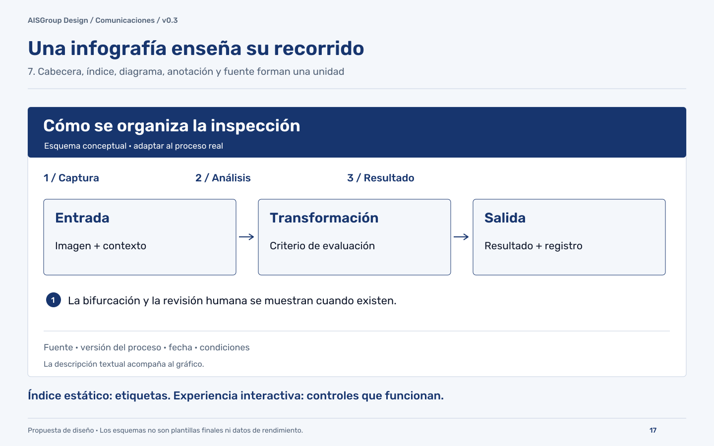

### 7.4. Gráficos y tablas

| Necesidad | Representación preferente |
| --- | --- |
| Comparar categorías | Barras con la misma escala |
| Mostrar evolución | Líneas con periodos y unidades identificados |
| Mostrar una distribución | Histograma o puntos, según el dato |
| Comparar especificaciones | Tabla con columnas homogéneas |
| Mostrar un proceso | Diagrama de pasos |
| Relacionar elementos | Diagrama con enlaces etiquetados |

En gráficos de barras, partir de cero. En líneas, si se recorta la escala, hacerlo explícito y evitar una lectura exagerada del cambio. No usar volumen 3D decorativo ni áreas que distorsionen magnitudes.

Para series múltiples, usar azul principal, azul profundo y cian solo donde el contraste lo permita, junto con marcadores o trazos diferentes. El azul claro se reserva a áreas de contexto; no debe desaparecer una serie esencial sobre blanco. Si hay demasiadas series, dividir el gráfico en pequeños paneles y etiquetar directamente.

Incluir fuente, fecha, unidad, tamaño de muestra cuando sea relevante y condiciones de cálculo. Un gráfico comercial debe poder rastrearse a sus datos. Las tablas priorizan alineación, espacio y separadores suaves sobre una cuadrícula densa; alinear números a la derecha y conservar precisión consistente.

**Ejemplo de aplicación.** La lámina siguiente representa tiempos sintéticos de 40, 60 y 80 minutos con barras desde cero y una tabla equivalente. Los datos están identificados como didácticos, sin atribuirlos a productos del grupo.

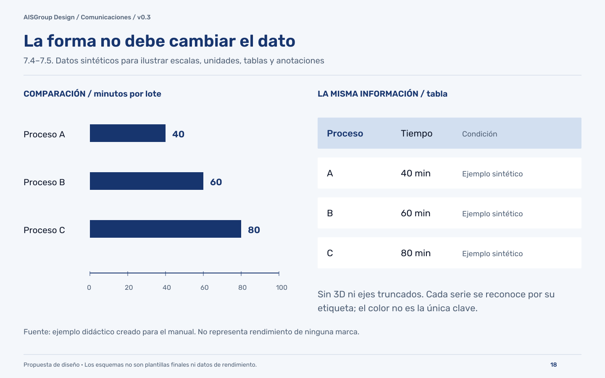

### 7.5. Anotaciones y accesibilidad

Numerar llamadas en el orden de lectura. Utilizar líneas cortas que no tapen el elemento señalado. El texto explica la observación, no solo señala «aquí».

Los datos esenciales también deben estar disponibles en texto, tabla o descripción ampliada. En piezas digitales, el orden de lectura del contenido debe seguir el orden visual. El color se acompaña de nombres, símbolos o patrones; una copia en escala de grises permite detectar dependencias excesivas del color, sin convertirse en una nueva variante autorizada de marca.

**Ejemplo de aplicación.** Una llamada «1» señala la región y explica qué se observa. La descripción textual repite el hallazgo y sus condiciones; no se limita a «ver zona azul».

## 8. Animaciones y audiovisual

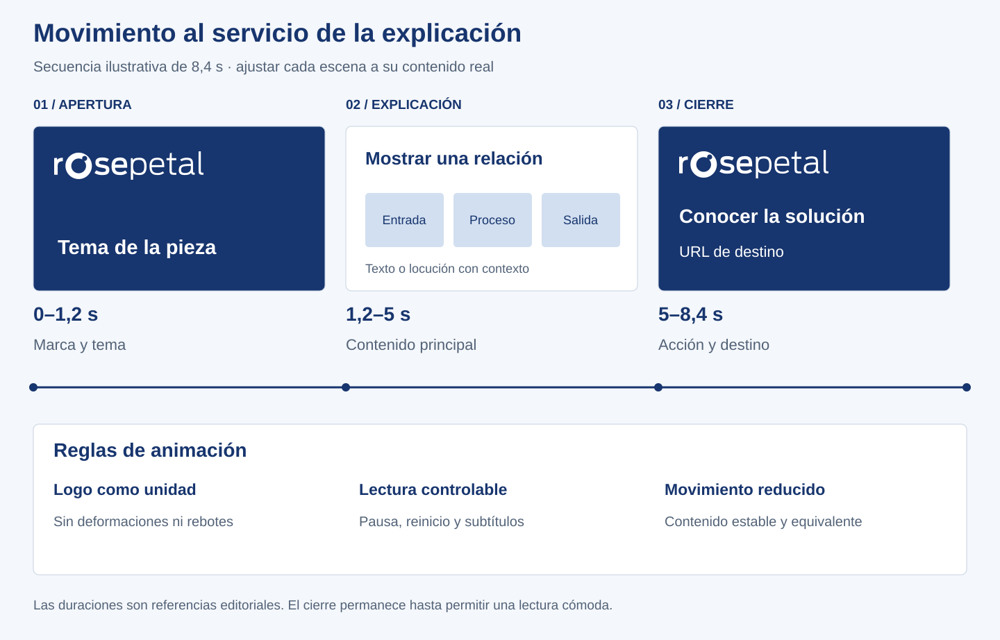

### 8.1. Principio de movimiento

El movimiento explica **secuencia, relación, cambio o foco**. Una animación debe seguir siendo comprensible en una versión estática o mediante un resumen textual cuando el movimiento no sea esencial.

El logo se anima como una unidad: opacidad o desplazamiento corto. No desmontar sus letras, deformarlo, aplicar rebotes ni convertir el símbolo en una mascota. Los descriptores permanecen ligados al conjunto.

**Ejemplo de aplicación.** En una explicación de inspección, primero aparece la imagen y después el criterio, si ese orden ayuda a comprender. El logotipo permanece estable; no se divide en letras para llenar la transición.

### 8.2. Ritmos de referencia

| Acción | Duración propuesta | Criterio |
| --- | --- | --- |
| Respuesta breve de un control | 120–180 ms | Inmediata y discreta |
| Aparición de un bloque | 240–400 ms | Opacidad y desplazamiento de 8–16 px en interfaz |
| Transición editorial entre escenas | 400–700 ms | Corte, fundido o desplazamiento sencillo |
| Apertura de marca | 0,8–1,5 s | Identificar sin retrasar la información |
| Cierre con acción | 2–3 s como punto de partida | Ampliar hasta que texto y destino puedan leerse |

En vídeo, los desplazamientos se adaptan al lienzo; no copiar literalmente distancias de una interfaz. Utilizar curvas de aceleración suaves y consistentes, sin rebote. Evitar animar a la vez más de dos focos de atención.

**Ejemplo de aplicación.** El storyboard de 8,4 s reserva 1,2 s para apertura, 3,8 s para explicación y 3,4 s para cierre. Es un ejemplo breve; si el contenido exige más lectura, se amplía la duración.

### 8.3. Aperturas, cierres y rótulos

Apertura: firma, título o tema y entrada rápida al contenido. Cierre: firma, una acción y un destino. Una pieza breve no necesita una introducción larga seguida de una segunda portada.

Los rótulos de persona ocupan una zona inferior libre: nombre y cargo o compañía en dos niveles. Permanecen el tiempo necesario para su lectura y no coinciden con subtítulos. Las etiquetas técnicas se sitúan junto al elemento explicado, manteniendo margen respecto a bordes y controles del reproductor.

Los fondos utilizan planos o el sistema hexagonal del apartado 3.4. La entrada del plano al volumen dura 900 ms como referencia y termina en un estado estático; firma y mensaje permanecen estables. No animar una trama detrás de párrafos o datos que se están leyendo.

**Ejemplo de aplicación.** Un rótulo identifica a la persona con nombre y cargo en dos líneas. Los subtítulos se desplazan a otra zona segura; ni el rótulo ni el logo tapan la pieza inspeccionada.

### 8.4. Vídeo, voz y subtítulos

Preparar un guion por escenas con imagen, texto en pantalla, locución, duración y fuente de cada evidencia. El vídeo puede partir de un original 1920 × 1080; la versión vertical requiere reencuadre y remaquetación propios.

La música acompaña sin competir con la voz; comprobar inteligibilidad en altavoces de portátil y móvil. Mantener un volumen consistente entre escenas. Registrar procedencia y derechos de música, voz, imágenes y vídeo.

Entregar subtítulos revisados, con puntuación y segmentación por sentido. Utilizar una o dos líneas por bloque y tiempo suficiente de lectura. Revisar especialmente nombres, siglas y vocabulario industrial. Ofrecer transcripción; cuando información visual esencial no esté expresada por el audio, incluirla en la narración o preparar su alternativa accesible.

Para publicación, preparar MP4 con codificación compatible con el destino y conservar un máster de mayor calidad. Entregar subtítulos SRT o VTT según el canal; los subtítulos incrustados pueden ser una adaptación adicional. La frecuencia de imagen se decide con el material de origen y el canal, manteniéndola consistente.

**Ejemplo de aplicación.** Cada fila del guion registra escena, imagen, locución, texto, duración y procedencia. «AIS Scanology» y «Rosepetal» se revisan también en los subtítulos automáticos.

### 8.5. Control y movimiento reducido

En experiencias web, respetar `prefers-reduced-motion` y ofrecer una presentación estable que conserve el contenido. Eliminar desplazamientos amplios, paralaje y zoom no esenciales en esa variante. La [técnica C39 del W3C](https://www.w3.org/WAI/WCAG22/Techniques/css/C39) explica el uso de esa preferencia.

Incluir pausa y reinicio en animaciones explicativas. No reproducir audio automáticamente. El contenido en movimiento que comienza automáticamente, dura más de cinco segundos y se presenta junto a otro contenido debe atender al criterio de [pausar, detener u ocultar](https://www.w3.org/WAI/WCAG22/Understanding/pause-stop-hide.html), salvo sus excepciones. Como regla de diseño del grupo, evitar destellos y parpadeos decorativos.

No utilizar un GIF como único soporte de una explicación que requiere control de lectura. En email, el primer fotograma debe comunicar por sí mismo el contenido esencial; ofrecer un enlace al vídeo o a la versión controlable.

**Ejemplo de aplicación.** La variante reducida muestra el estado final del diagrama y permite avanzar manualmente. Si el primer fotograma de un GIF no explica el tema, el email necesita además un titular y una acción HTML.

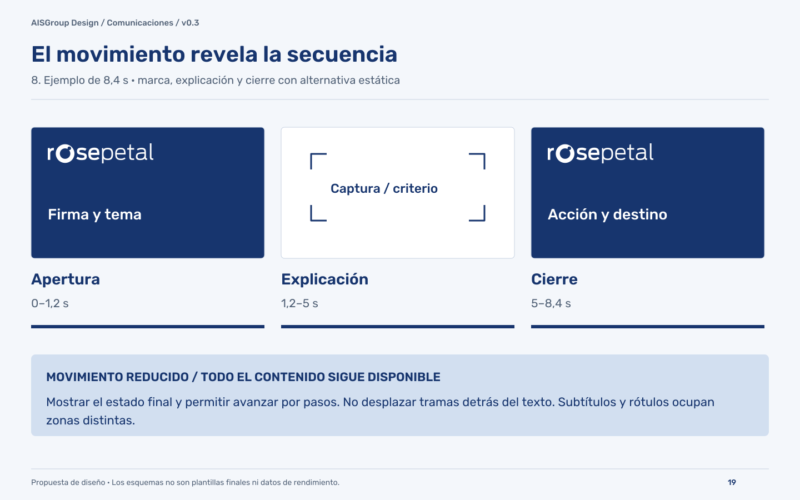

## 9. Experiencias interactivas

### 9.1. Estructura editorial compartida

Demos, infografías interactivas y animaciones web comparten cuatro zonas: **cabecera, navegación, contenido y pie**. La lámina del apartado 7 muestra esta organización. No es obligatorio ocupar una zona cuando no aporta información.

| Zona | Reglas |
| --- | --- |
| Cabecera | Logo de emisor, título y acceso a la acción principal cuando proceda |
| Navegación | Secciones o pasos con estado actual visible; etiquetas de contenido |
| Contenido | Una tarea o explicación principal por vista |
| Pie | Fuente, versión, notas y contacto; controles de reproducción en un bloque propio |

Referencia de altura de cabecera: **80 px en escritorio y 64 px en móvil**, ajustable para respetar el tamaño mínimo del logo. Si una firma con descriptor no cabe de forma legible, aumentar la cabecera o cambiar la composición; no eliminar el descriptor por cuenta propia.

El cuerpo editorial parte de un ancho máximo de 1200 px y márgenes del apartado 3. Las visualizaciones que requieren más espacio pueden ocupar el ancho disponible con controles y explicación accesibles.

**Ejemplo de aplicación.** Una demo de proceso abre con emisor y título, muestra los pasos debajo y reserva el pie para versión y notas. Sus controles de reproducción ocupan una banda propia.

### 9.2. Navegación y comportamiento

En una secuencia, mostrar paso actual y permitir avanzar y volver. En secciones independientes, utilizar enlaces o pestañas según corresponda a su comportamiento. Los controles deben mantener su posición cuando cambie el contenido para evitar saltos de atención.

En móvil, apilar el contenido según prioridad y convertir el menú cuando no quepa. No reducir una versión de escritorio como una imagen. Las tablas o diagramas extensos pueden tener una zona de desplazamiento identificada, con alternativa textual; el texto principal debe seguir siendo legible sin desplazamiento horizontal.

Las cabeceras o pies fijos no deben ocultar contenido ni foco al usar teclado o ampliar la página. Conservar enlaces identificables, orden de tabulación lógico y etiquetas de control comprensibles.

**Ejemplo de aplicación.** Al avanzar de «Captura» a «Análisis», los botones anterior/siguiente mantienen posición y el paso activo conserva nombre visible. El usuario puede volver sin reiniciar toda la demo.

### 9.3. Acciones y estados

Una vista tiene una acción primaria. Usar verbo y objeto: «Ver resultado», «Reiniciar simulación», «Descargar ficha». Los enlaces navegan a destinos; los botones ejecutan acciones. No utilizar un elemento decorativo como control sin nombre y comportamiento accesible.

Estados mínimos que debe contemplar una experiencia: inicio, carga, resultado, ausencia de datos y error. Los datos de demostración se identifican como simulados. Un error indica qué ha ocurrido y cómo continuar, sin culpar al usuario.

Adoptar áreas de activación de **44 × 44 px como objetivo interno** para controles principales. La referencia WCAG 2.2 AA de tamaño mínimo es 24 × 24 px CSS o las condiciones alternativas y excepciones del [criterio 2.5.8](https://www.w3.org/WAI/WCAG22/Understanding/target-size-minimum.html); el objetivo interno no se presenta como ese mínimo normativo.

El foco debe ser visible en todos los fondos. Comprobar contraste del indicador, funcionamiento por teclado y que una selección no se comunique únicamente con color. Los tooltips complementan el contenido; no contienen la única explicación disponible.

**Ejemplo de aplicación.** En ausencia de imagen se muestra «No hay imagen disponible» con la acción «Cargar ejemplo». No se deja el área vacía ni se muestra un resultado simulado como si fuera una inspección real.

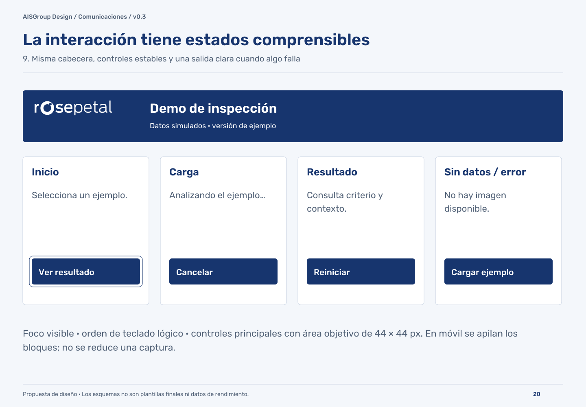

### 9.4. Relación con el Design System

Este manual especifica el resultado visual y editorial. El Design System implementará componentes y estados reutilizables para Tailwind, Vuetify, PrimeVue + Tailwind y shadcn-vue + Reka UI + Tailwind.

Una experiencia elige un stack para su implementación y consume los valores compartidos. No mezcla bibliotecas para obtener variantes estéticas de un mismo botón o menú. Si falta un componente, se registra la necesidad y se documenta la solución provisional para su incorporación posterior.

**Ejemplo de aplicación.** Una demo con PrimeVue consume la paleta y los componentes del adaptador de ese stack. La misma dirección editorial puede aplicarse a Vuetify sin copiar los componentes entre bibliotecas.

## 10. Plantillas, entrega y mantenimiento

### 10.1. Catálogo de plantillas

La siguiente tabla define el alcance de las plantillas a producir. **«Especificada» significa que sus reglas están en este manual; no implica que ya exista el archivo editable**. Los recursos disponibles se enlazan expresamente.

| ID | Plantilla | Original y variantes previstos | Estado en esta entrega |
| --- | --- | --- | --- |
| COM-01 | Hoja corporativa y carta | A4; marcas e idiomas | Especificada, editable pendiente |
| COM-02 | Informe | A4; portada, interiores, tabla y anexos | Especificada, editable pendiente |
| COM-03 | Firma de correo | HTML y logo PNG derivado; por persona | Especificada, implementación pendiente |
| COM-04 | Presentación | 16:9; patrones de los siete tipos de diapositiva | Especificada, editable pendiente |
| COM-05 | Propuesta comercial | A4; alcance, planificación y oferta | Especificada, editable pendiente |
| COM-06 | Brochure | A4 de 2 y 4 páginas | Especificada, editable pendiente |
| COM-07 | Ficha técnica | A4 de 1 y 2 páginas | Especificada, editable pendiente |
| COM-08 | Caso de éxito | Documento y adaptación web | Especificada, editable pendiente |
| COM-09 | Publicación y carrusel | 1:1 y 4:5; variantes de campaña | Especificada, editable pendiente |
| COM-10 | Banner y cabecera | 8:3, 16:9 y adaptación móvil | Especificada, editable pendiente |
| COM-11 | Mailing y newsletter | HTML responsive y texto alternativo | Especificada, implementación pendiente |
| COM-12 | Infografía | Horizontal y vertical; cabecera, cuerpo y pie | Especificada, editable pendiente |
| COM-13 | Vídeo y animación | Apertura, cierre, rótulo y subtítulos | Especificada, proyecto editable pendiente |
| COM-14 | Experiencia interactiva | Cabecera, menú, cuerpo, pie y controles | Especificada, integración con Design System pendiente |
| COM-15 | Tarjeta | 85 × 55 mm, ajustable a imprenta | Especificada, editable pendiente |
| COM-16 | Brief de pieza | Markdown | [Disponible como plantilla de trabajo](../../assets/communications/templates/draft/v0.2/brief.md) |

Las láminas SVG del manual ilustran esas reglas y pueden inspeccionarse como vectores. No sustituyen los originales editables de las plantillas del catálogo.

**Ejemplo de aplicación.** COM-07 define una ficha y sus reglas; no se anuncia como plantilla descargable hasta que exista el original editable. Los SVG de ejemplo permanecen marcados como ilustraciones.

### 10.2. Variantes y adaptación

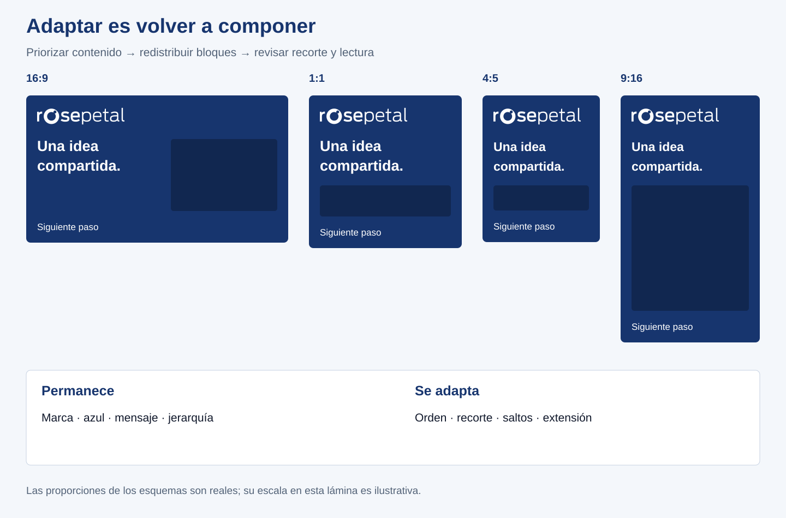

Cada plantilla mantiene como elementos fijos: retícula, jerarquía, firma, estilos de texto, pie y comportamiento de los módulos. Sus campos variables son: marca emisora, idioma, título, contenido, evidencia, acción y metadatos.

Para adaptar un formato, seguir este orden: **priorizar contenido → redistribuir bloques → recortar la imagen → ajustar saltos → revisar tamaños**. No distorsionar todo el conjunto ni usar la reducción tipográfica como primera solución.

Las variantes por marca cambian la firma y el contenido; mantienen el azul y el lenguaje común. Las variantes por idioma preservan significado y evidencias, permitiendo el espacio que necesite la traducción.

**Ejemplo de aplicación.** Una ficha en español que pasa a inglés conserva datos, firma y jerarquía. Se amplía el cuadro de texto o se ajustan saltos; no se reduce todo el cuerpo para mantener las mismas líneas.

### 10.3. Archivos y nomenclatura

Nombre de entrega: `{marca}_{pieza}_{tema}_{idioma}_{formato}_{version}.{ext}`. Usar minúsculas, guiones dentro de un campo y guiones bajos entre campos, sin espacios ni tildes.

Ejemplo: `rosepetal_ficha_inspeccion-visual_es_a4_v0.2.pdf`. El tema es un identificador, no una denominación nueva de producto. Para campañas recurrentes, añadir fecha ISO al tema cuando evite ambigüedad.

Conservar por pieza: original editable, exportaciones, imágenes autorizadas, datos utilizados, brief y registro de revisión. No incluir credenciales ni archivos privados de un cliente en recursos compartidos. Los assets comunes viven en `assets/`; los paquetes de campaña se organizan con su propio brief y versión cuando se creen.

| Destino | Entrega | Revisión específica |
| --- | --- | --- |
| Documento digital | Editable + PDF | Texto seleccionable, enlaces, fuentes y orden de lectura |
| Imprenta | Editable + PDF según proveedor | Tamaño final, sangrado, perfil, fuentes y prueba |
| Imagen social | PNG para gráficos o JPEG para fotografía; original editable | Dimensiones, peso, texto y recorte real |
| Web | SVG para vectores; imágenes optimizadas y fuente editable | Responsive, alternativas de texto y carga |
| Email | HTML + versión de texto + imágenes | Clientes objetivo, imágenes bloqueadas y modo oscuro |
| Vídeo | Proyecto, máster, MP4 y subtítulos | Reencuadre, audio, lectura y reproducción |
| Infografía | SVG o editable equivalente + exportaciones | Fuentes de datos, leyenda y alternativa textual |

Para impresión, **3 mm de sangrado y 300 ppp efectivos en fotografía** son valores de partida de producción, sujetos al proveedor y soporte. No convertir a CMYK sin conocer el perfil ni añadir marcas de corte cuando el proveedor no las solicite. Logos y diagramas permanecen vectoriales siempre que el proceso lo admita.

**Ejemplo de aplicación.** Paquete: original editable, PDF revisado, imágenes y datos, y brief. Archivo de ejemplo: `rosepetal_ficha_inspeccion-visual_es_a4_v0.3.pdf`; el nombre técnico en minúsculas no cambia la grafía Rosepetal en el contenido.

### 10.4. Brief mínimo

Toda pieza registra: marca emisora, responsable, público, objetivo, mensaje central, evidencia y sus fuentes, idioma, canal, dimensiones, acción, destino, fecha, materiales disponibles y limitaciones. El [brief reutilizable](../../assets/communications/templates/draft/v0.2/brief.md) incluye esos campos.

Si falta una cifra, una imagen o una URL, conservar un marcador inequívoco en el borrador: `[DATO PENDIENTE]`, `[IMAGEN PENDIENTE]` o `[URL PENDIENTE]`. No entregar una pieza final con esos marcadores ni sustituirlos por datos plausibles.

**Ejemplo de aplicación.** Brief de ejemplo: emisor AIS Vision Systems; público calidad; objetivo explicar el flujo; soporte A4; evidencia imagen validada; acción solicitar demo. Si falta una URL, el borrador conserva `[URL PENDIENTE]`.

### 10.5. Instrucciones para agentes de IA

Al producir una pieza, el agente debe:

1. Leer el brief y las versiones aplicables de los manuales.
2. Consultar el catálogo y recuperar el logo y los recursos exactos de la marca emisora.
3. Seleccionar una composición y las reglas del soporte.
4. Utilizar los tokens disponibles y mantener el azul principal sin aproximaciones.
5. Separar contenido proporcionado, contenido redactado y datos pendientes de verificar.
6. Generar una versión editable con sus exportaciones y evidencias de revisión.
7. Registrar recursos utilizados, versión, cambios y asuntos pendientes.

El agente puede adaptar longitud, composición y formato dentro de estas reglas. Debe documentar como propuesta cualquier nuevo recurso o excepción. No debe regenerar logos, atribuir aprobación a un borrador, inventar datos ni publicar o enviar una pieza sin la autorización correspondiente a la tarea.

La futura plataforma **Web + MCP** expondrá el mismo contenido. El agente podrá recibir **Markdown** para reglas y briefs, **DTCG** para tokens, **JSON** para catálogos y metadatos, **CSS** para variables, **código** para implementaciones y **enlaces** a los recursos exactos. Estos formatos son distintas formas de acceso a las mismas definiciones; el servicio todavía no está implementado.

**Ejemplo de aplicación.** Ante «crea un banner de AIS Scanology», el agente recupera nombre exacto, logo, receta de fondo y formato; selecciona una trama por la función del mensaje y registra sus versiones.

### 10.6. Revisión y publicación

| Revisión | Comprueba | Responsable funcional propuesto |
| --- | --- | --- |
| Contenido | Mensaje, idioma, datos, fuentes y acción | Responsable de la pieza |
| Técnica o comercial | Capacidades, condiciones y alcance | Responsable de producto, proyecto o comercial |
| Diseño | Marca, composición, legibilidad y consistencia | Responsable de diseño o comunicación |
| Producción | Formato, exportación, canal y enlaces | Persona que prepara la publicación |

Una persona puede cubrir varias funciones; debe quedar claro quién da por válida la versión final. Los estados propuestos son `draft`, `in-review`, `approved` y `retired`; `reference` identifica antecedentes e `illustration` ejemplos explicativos. Se amplía así la nomenclatura inicial del catálogo sin cambiar el significado de los estados existentes.

Lista de revisión previa a entrega:

- [ ] Marca, nombre, logo, variante y protección correctos.
- [ ] Azul principal exacto y paleta aplicada según función.
- [ ] Mensaje comprensible, evidencia verificada y una acción principal.
- [ ] Ortografía, idioma, nombres, cifras y unidades revisados.
- [ ] Contraste y tamaño de lectura comprobados en el formato final.
- [ ] Imágenes y capturas autorizadas, identificadas y legibles.
- [ ] Enlaces, QR, formularios y archivos de descarga comprobados.
- [ ] Adaptaciones de pantalla, móvil, impresión o reproducción revisadas según destino.
- [ ] Alternativas de texto, subtítulos o controles incluidos cuando correspondan.
- [ ] Sin marcadores pendientes; editable, exportación, versión y revisión registrados.

**Ejemplo de aplicación.** Una revisión confirma el nombre, el azul, la lectura del titular, el recorte real y el destino de la acción. El estado cambia cuando la revisión se registra; no por haber exportado un PDF.

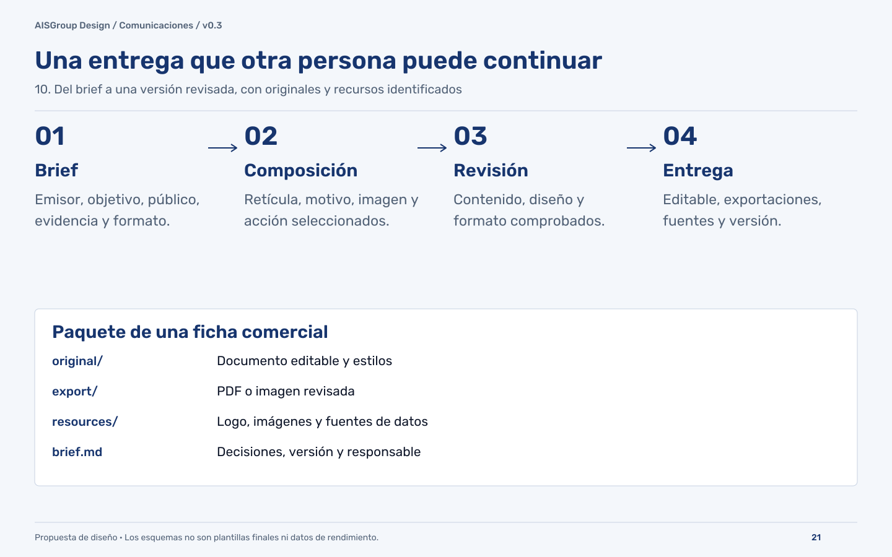

### 10.7. Mantenimiento y evolución

Cada recurso registra identificador, ruta, versión, estado, procedencia y hash. La aprobación añade responsable y fecha. Los recursos retirados conservan trazabilidad y dejan de presentarse como opción vigente en el catálogo.

Cambiar una regla compartida exige actualizar el manual, sus ejemplos y los valores derivados afectados. Una nueva campaña que usa reglas existentes no requiere una versión nueva del manual. Registrar las excepciones repetidas como necesidades de mejora del sistema.

La v0.4 sustituye la dirección gráfica y los fondos v0.3 por el sistema hexagonal del apartado 3.4. Añade nueve láminas y ocho recursos: seis horizontales y dos verticales. Conserva los ejemplos de los demás apartados, los valores de la paleta v0.1, los nombres exactos y la propuesta provisional de impresión. Las versiones anteriores conservan trazabilidad; el catálogo distingue los recursos retirados de los utilizables.

**Ejemplo de aplicación.** Los fondos v0.2 y v0.3 se conservan como antecedentes; los nuevos encargos recuperan las variantes hexagonales v0.4. Cambiar la paleta o el Pantone posteriormente exige actualizar las definiciones y las piezas afectadas.

## 11. Recursos y referencias

### 11.1. Recursos del repositorio

| Recurso | Ubicación |
| --- | --- |
| Manual de marca | [manual-de-marca.md](../brand/manual-de-marca.md) |
| Logos y procedencia | [Catálogo de marca](../../assets/brand/catalog.json) |
| Azul principal y tipografía DTCG | [brand-v0.1.tokens.json](../../assets/brand/palette/brand-v0.1.tokens.json) |
| Paleta auxiliar DTCG | [communications-v0.1.tokens.json](../../assets/communications/palette/communications-v0.1.tokens.json) |
| Variables CSS de marca | [brand-v0.1.css](../../assets/brand/palette/brand-v0.1.css) |
| Variables CSS auxiliares | [communications-v0.1.css](../../assets/communications/palette/communications-v0.1.css) |
| Contrastes calculados | [contrast-v0.1.json](../../assets/communications/palette/contrast-v0.1.json) |
| Láminas de los demás apartados | [Figuras v0.3](../../assets/communications/figures/v0.3/) |
| Láminas anteriores | [Figuras v0.2](../../assets/communications/figures/v0.2/) |
| Ocho fondos hexagonales | [Fondos v0.4](../../assets/communications/backgrounds/draft/v0.4/) |
| Construcción y aplicaciones hexagonales | [Nueve figuras v0.4](../../assets/communications/figures/v0.4/) |
| Revisión visual | [Galería HTML](../../assets/communications/previews/v0.4/index.html) · [Vista general SVG](../../assets/communications/figures/v0.4/09-overview.svg) |
| Definición del sistema | [graphic-system-v0.4.json](../../assets/communications/graphic-system-v0.4.json) |
| Referencias y decisiones vigentes | [referencias-visuales-v0.4.md](referencias-visuales-v0.4.md) |
| Auditoría web y propuesta anterior | [referencias-visuales-v0.3.md](referencias-visuales-v0.3.md), conservada como antecedente |
| Impresión del azul principal | [primary-blue-v0.1.json](../../assets/brand/print/primary-blue-v0.1.json) |
| Brief reutilizable | [brief.md](../../assets/communications/templates/draft/v0.2/brief.md) |
| Índice y estado de recursos de comunicación | [catalog.json](../../assets/communications/catalog.json) |

Los tokens auxiliares complementan los de marca: combinar sus grupos `color` conservando `color.primary` del archivo de marca; no reemplazar el grupo completo. En CSS, cargar primero las variables de marca y después las de comunicaciones. La paleta auxiliar no redefine el azul principal.

**Ejemplo de aplicación.** Para una portada: manual de marca + logo exacto + regla 3.4 + fondo elegido. Para impresión se añade el registro Pantone/CMYK. No es necesario cargar todo el catálogo para una sola pieza.

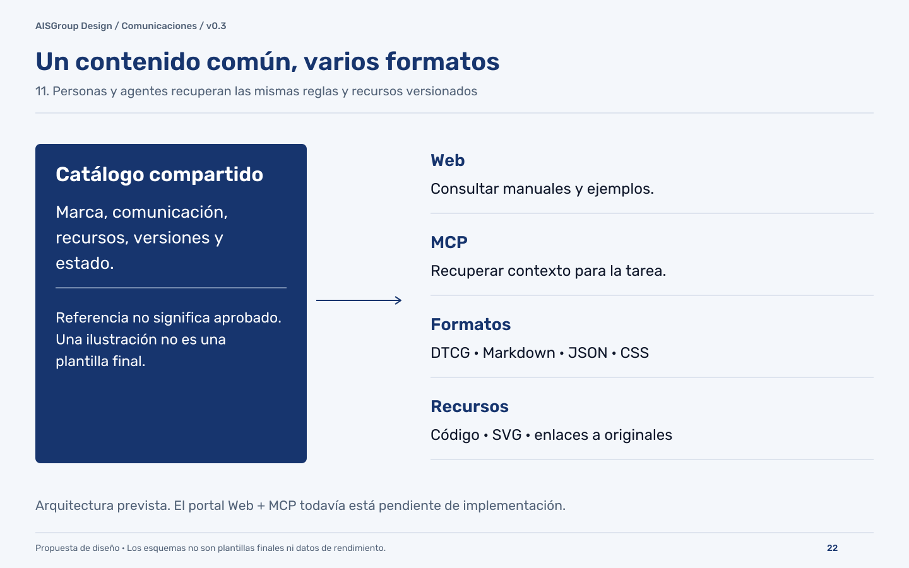

### 11.2. Fuentes y alcance de las decisiones

La continuidad con los documentos aportados y las webs del grupo se documenta en [Fuentes y decisiones de marca](../brand/fuentes-y-decisiones.md). La paleta auxiliar, las medidas editoriales, las retículas, los ritmos y las composiciones de este manual son propuestas de diseño del proyecto.

Referencias técnicas consultadas el **5 de octubre de 2026**:

- [W3C — Contraste mínimo](https://www.w3.org/WAI/WCAG22/Understanding/contrast-minimum.html).
- [W3C — Contraste no textual](https://www.w3.org/WAI/WCAG22/Understanding/non-text-contrast.html).
- [W3C — Tamaño mínimo del objetivo](https://www.w3.org/WAI/WCAG22/Understanding/target-size-minimum.html).
- [W3C — Pausar, detener, ocultar](https://www.w3.org/WAI/WCAG22/Understanding/pause-stop-hide.html).
- [W3C — Técnica C39 para movimiento reducido](https://www.w3.org/WAI/WCAG22/Techniques/css/C39).
- [Mailchimp — Diseño de email](https://templates.mailchimp.com/design/) y [texto alternativo](https://mailchimp.com/help/add-alt-text-to-images/).
- [Pantone 534 C](https://www.pantone.com/color-finder/534-c) y [Color Bridge](https://www.pantone.com/products/graphics/color-bridge-guide-set-coated-uncoated), para identificar el candidato y el proceso de comparación física. La receta CMYK es una propuesta propia.
- [DTCG Format Module 2025.10](https://www.designtokens.org/tr/2025.10/format/), referencia de los tokens ya incorporados al proyecto.

Los tamaños de campaña son formatos internos de trabajo. Las especificaciones del canal y las condiciones de impresión se comprueban al producir cada entrega.

**Ejemplo de aplicación.** La malla de AIS Group es un antecedente observado; la malla de 64 px del sistema es una decisión nueva. La referencia a una web no convierte esa geometría propuesta en una regla histórica.

