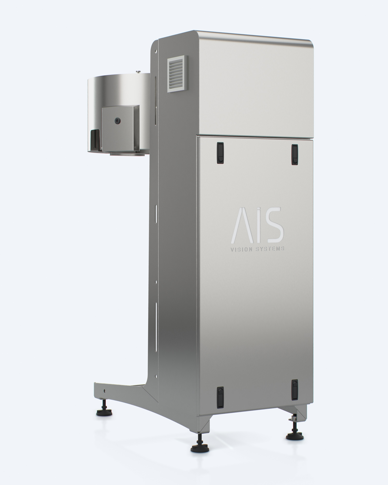
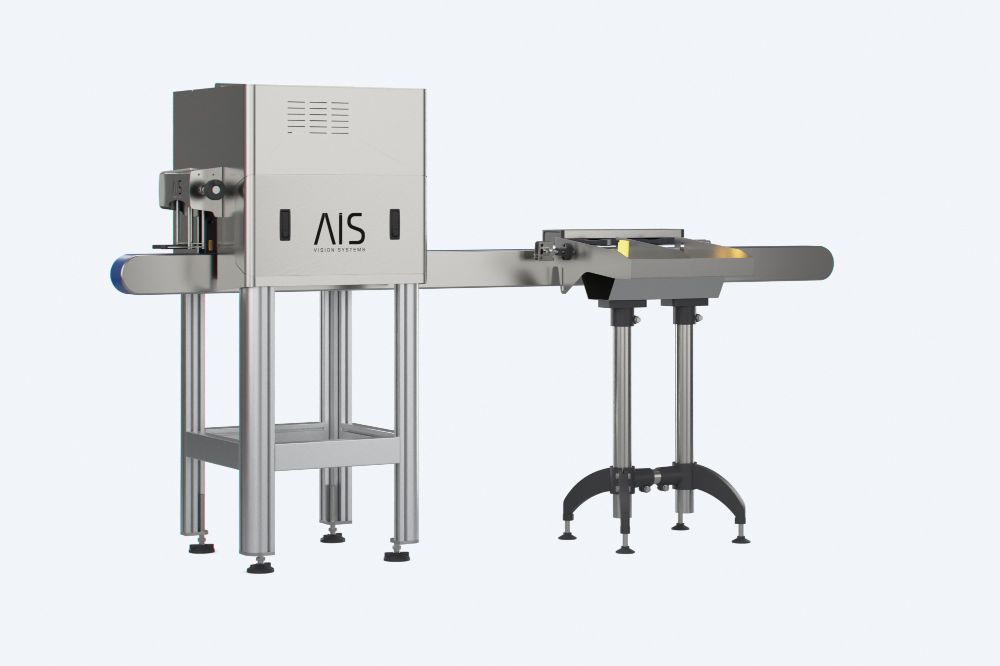
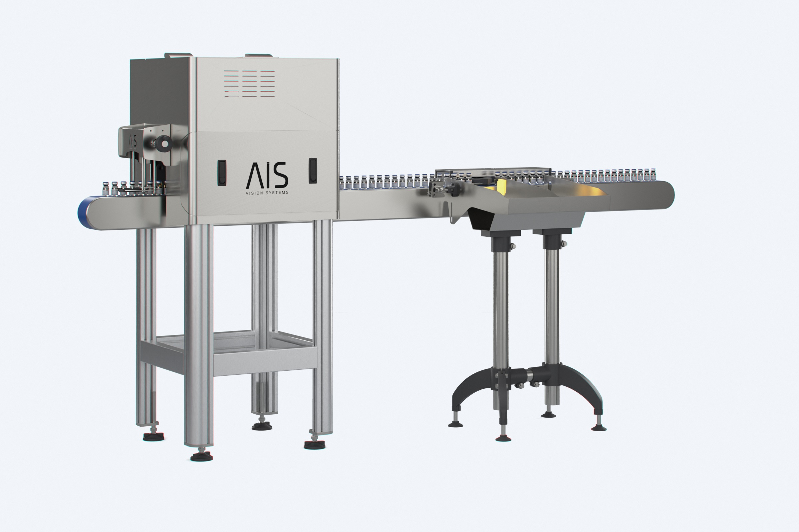
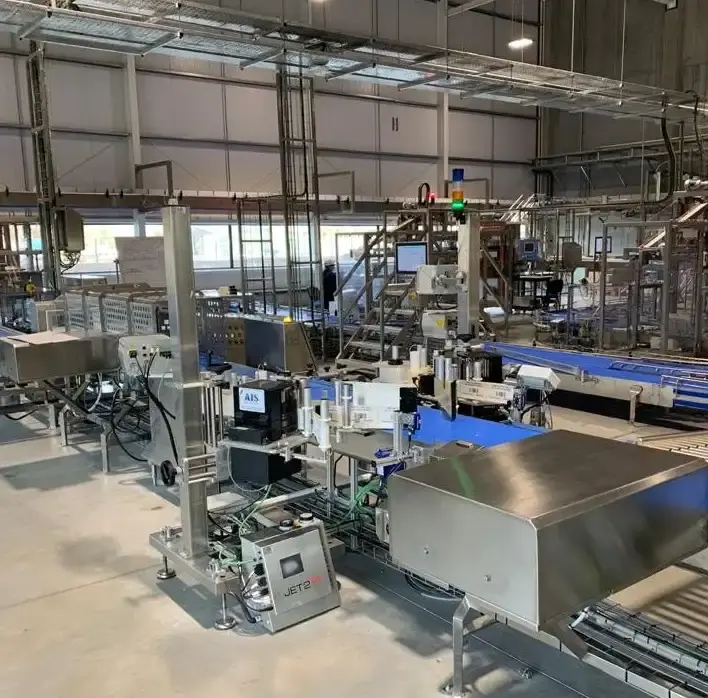
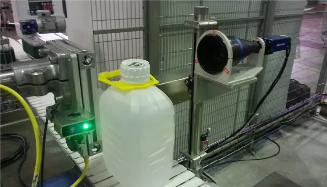
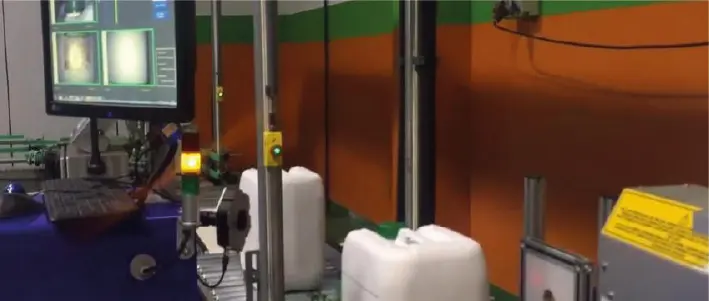
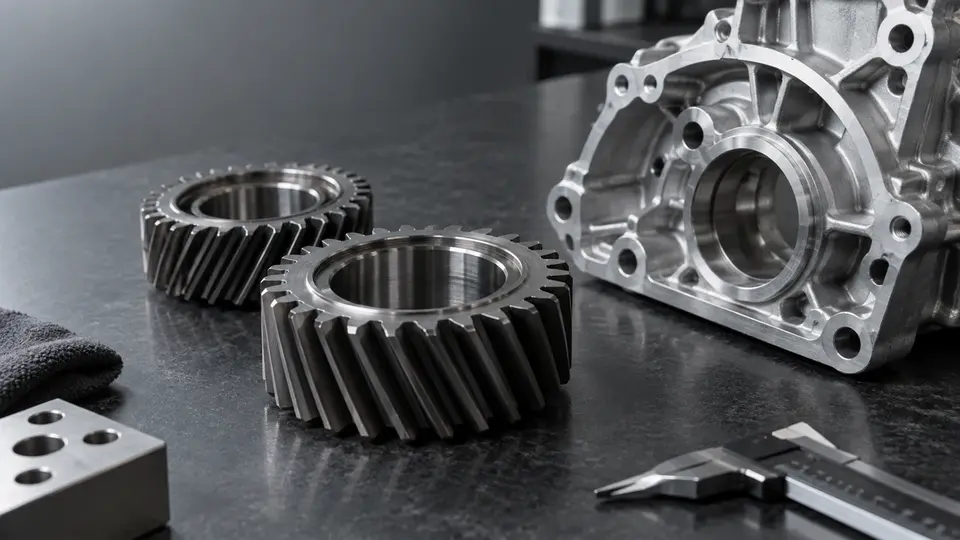
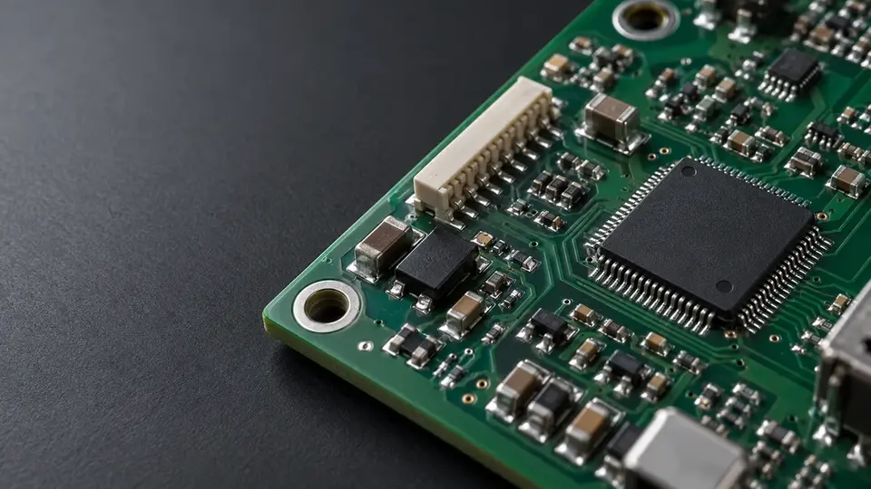
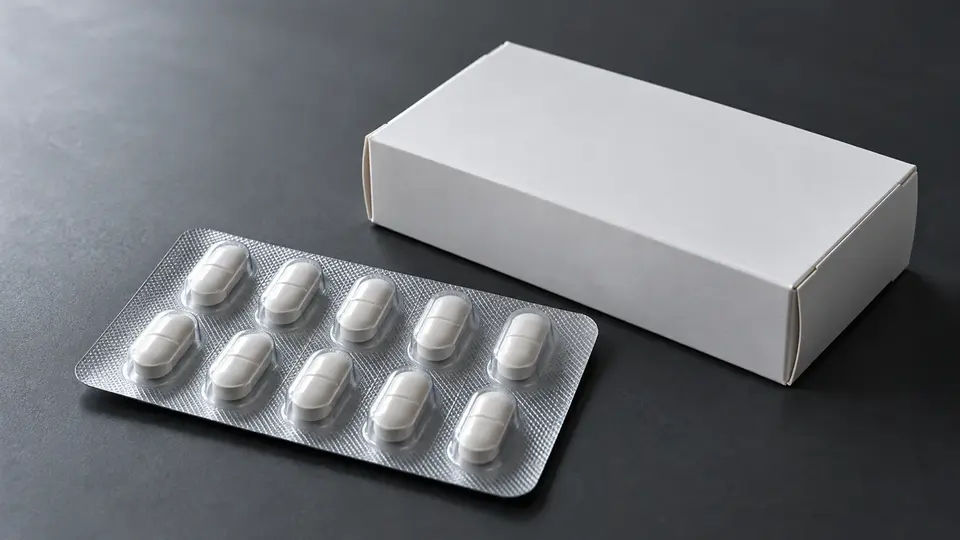

# Imagery

Choose images by what they show and the evidence they provide.

## Choose by intent

Start from the message, not from the image bank. Each message has one image type that proves it.

| When you need to say | Use |
| --- | --- |
| This is what we build | [Machine](#type-machine) |
| It works in a real factory | [In production](#type-line) |
| It catches what matters | [Detail and result](#type-result) |
| The software is real and usable | [Interface](#type-interface) |
| We understand your industry | [Industry subject](#type-subject) |
| You will talk to experts | [People](#type-people) |
| This is how it works | Illustration |

## Image types

Each type has a purpose, approved references and a direction for anyone shooting, selecting or briefing it. The references are the standard: a new image should sit comfortably next to them.

### Machine

The real machine in a studio on a light grey seamless background. Three-quarter view from operator eye height, soft even light, the whole machine in frame with room around it, screens on and showing the real interface. Until a photograph exists, an exterior view from the engineering model on the same background, every guard closed.

### In production

The machine installed in its real line, shot at working height with product flowing. Available light balanced with fill; the background reads as a factory without becoming the subject. Operators may appear with their consent.

### Detail and result

A matched pair from the same viewpoint and light: the good part, and the same part with one real-world defect such as a missing tablet, a scratch or a crooked cap. Photographed, rendered or generated, the image never contains the detection: boxes, masks and the verdict are drawn on top in the layout with the overlay kit, in brand colours only. Real results with figures always come from the system itself.

### Interface

Real screenshots at 1× or 2×, cropped to the task, with a demo dataset or anonymised customer data. No browser frame unless the context needs one, and no retouched values. Photographs of the screen in use on the line are welcome.

### Industry subject

A still life of the product category: machined parts, circuit boards, blister packs, bottles. Dark slate or light grey matte surface, one soft key light from the upper left, shallow depth of field, neutral grade. No brands, text or people.

### People

Portraits from the shoulders up on a light neutral background, soft natural light, eye contact, everyday work clothes. At events, keep the stand and a machine in frame.

## Never

Generic «AI» imagery promises magic. Our customers buy proof, so these images are never used, whoever made them: floating holograms and data cubes, glowing blue sci-fi light, robots with faces, invented brands, and text baked into a photograph.

## Generated and composited images

Real photographs, our product renders and the exterior views of our machines come first. A generated or composited image may be used when the end result is credible at the size it is published; judge the result, not the tool. Real results with figures always come from the system.

**Use when it holds up**

- Real photographs, footage and screenshots first
- Product still lifes and Detail and result pairs rendered to real dimensions
- A generated or composited image that is credible at its final size, client brands blurred

**Reject**

- Garbled, melted or invented-looking text on screens, labels or packs
- Impossible geometry, light or reflections; parts that float, fuse or repeat
- A machine that is not the AIS machine it is said to be, or a logo pasted onto another maker’s machine
- Invented brands, or client brands left legible
- Boxes, masks, labels or verdicts baked into the image

**Before you use one**

- Look at it at 100% and at its final size: every letter on screens, labels and packs reads as real text, or is not there.
- It is physically plausible: real geometry, parts that fit and are supported, nothing melted, fused or duplicated.
- In a pair, the defect is the only difference, it happens in production, and it can be seen without its overlay.
- It sits beside the rest of the piece in light, surface and grade.
- It does not suggest a customer, an installation or a measured result it does not have.

## Renders, machines and customer material

- **Product renders** (a still life, a good part beside its defective twin, a detection tile) are built to the product’s real dimensions in one studio look: one sweep, one light from the upper left, one framing per set, so only the defect changes. They are placed as ordinary pictures with no «illustration» caption, and their alt text describes the product like a photograph. Where a render is recorded (the asset library, the working notes), it is recorded as a render; on the page, in a caption or in a file name it is never called a render, CAD or 3D.
- **Our machines** may be shown as exterior views from the engineering models until real photographs exist: guards closed, no cutaways, internals, optics or dimensioned views. A machine on a cover or a banner is working, with its product, and is always the machine it is named as.
- **Detection tiles** are square, show one defect each on our demo product with no overlay, and share one product, one lens and one framing per machine; each is cropped on its own defect and never printed larger than its native size.
- **Customer material** (camera frames, screens and photos from customer lines) may be reused with client logos, brand marks and identifying codes blurred: a soft blur, no black boxes, nothing invented. The unblurred crop stays internal. A customer line needs the customer’s approval before publishing.
- **Real first.** Search the asset library for a real photograph, footage or screen before making or generating anything. Only assets with status approved go into a piece; a video frame is never a cover.

## Detection overlays

Boxes, masks, readings, measurements and verdicts are drawn on top of the image by one renderer, [`overlay.mjs`](../../../brand/downloads/overlays/overlay.mjs), from a short JSON spec. The examples above are rendered by the same file; download their specs from each caption.

| Rule | Detail |
| --- | --- |
| **Kit colours only** | Detections `#3664B3`, or `#A7BFE4` on dark images. Defects `#DC2626`, or `#F87171` on dark images. Verdict chips are filled with white text: pass on success-solid `#15803D`, reject on `#DC2626`; a pass is never shown by colour alone. No other colours, gradients, glows, shadows or rounded corners. |
| **Line weights** | At display size: a found object gets 2 px corner brackets on a 1 px hairline; a defect a full 2 px frame over an 8% tint, so it differs by shape, not only by colour. Masks fill at 20% (defects 28%) inside a smooth 2 px edge. Readings get a highlighter tint and a 2 px rule under the text. Measurements are drawn like a technical drawing: a 2 px dimension line, extension ticks, closed arrowheads, the value in a break of the line. Every line sits on a 1 px casing (white under the dark colours, ink under the light ones), so it keeps 3:1 on any picture; no blur or glow. |
| **One verdict** | One verdict per image, top left: a 28 px chip with a check or an x, OK or NOK, and a short count or reason after a divider. |
| **Label tabs** | 20 px tall, solid in the state colour and flush on the box’s corner, so ownership is never in doubt. Inter Semibold 12 px for the class, Medium for the value, tabular figures; white on the dark colours, ink on the light ones (4.5:1 or more). A defect tab leads with an x. Read values in JetBrains Mono. Text is centred on the cap height, never on the font box. |
| **Never cover the evidence** | A tab sits on a box’s corner, over a mask’s highest point, beside a reading and in a measurement’s line; the renderer moves it to the first free place and never onto another box, mask, tab or the verdict. Set `"chip"` to try a side first. |
| **Masks from a tool** | Mask points come from the system’s export or a segmentation model, never traced by eye; the renderer draws a smooth contour through them, or straight edges with `"smooth": false` for square parts. Without a tool, use a box. |
| **Label sparingly** | One label per kind of object; the rest are boxes only. A defect label says what was expected. |

**For campaigns and launches**

The examples on this page show the style. A marketing piece also needs:

1. A base image of at least 2400 px on the long side, a photograph, a product render or a generated pair that passes the checks above.
2. Masks exported from the Rosepetal app’s smart polygon tool, or from the inspection system itself, so every outline follows the real edge.
3. A final check at 100% zoom: every outline sits on the part’s edge, and every chip is clear of the evidence.

## Treatment

| Format | Ratio | Use |
| --- | --- | --- |
| Web opener | 16:9 | Home, industry and campaign openers |
| Card | 4:3 | Industry and solution cards |
| Social post | 4:5 | LinkedIn and Instagram feeds |
| Square headshot | 1:1 | Team, speakers, authors |
| Document | 3:2 | Datasheets, case studies, slides |

- Keep a neutral, true-to-life grade across a set. No filters, duotones or heavy vignettes.
- Crop to the subject; leave space for a headline in the layout, never on top of detail.
- Text goes in the layout, not in the image. Captions name the place, the year and, for results, the conditions.
- Every installation needs the customer’s approval and every person their consent. Record both with the file.

## Backgrounds

Use flat colour and the plain brand-blue ground. No gradients or glow.

The hexagon is an AIS brand device. Use it in two forms:

- **The hexagon pattern.** An outline grid of flat-topped hexagons. The stroke is a hairline at about 15 to 30% opacity: white or `#7C9FD7` on brand blue `#17356E` and deep blue `#10254C`, `#3664B3` on white. It fades out from one corner or edge, on those grounds or behind a text panel.
- **The single hexagon.** An outline hexagon that holds an icon, a step number or a small mark.

See the [decorative patterns](patterns.md) for every medium and their light and transparent variants. No glow or gradient fills. Fading line opacity is allowed. Keep the original geometry; never cut a cell edge into an odd shape.
