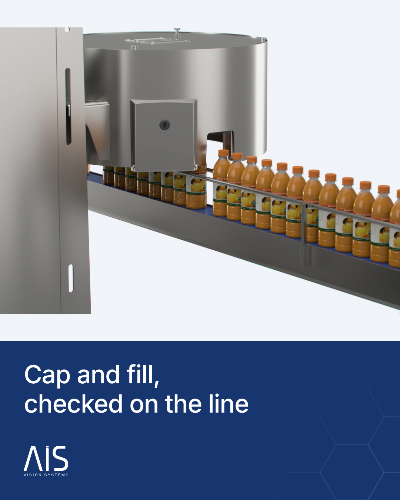

# Retained source rules

Read only the IDs relevant to the current task. Source evidence and dated conflict resolutions are in evals/rules-ledger.json.

## AIS-1b19b0408475

<!-- AIS-1b19b0408475 -->
Build posts and carousels from the approved kit and one clear message.

Source: guide/src/content/guide/en/social.mdx:16.

## AIS-137051e84a7e

<!-- AIS-137051e84a7e -->

Source: plugin/skills/communications/references/social.md:11.

## AIS-6f6e31ff6c34

<!-- AIS-6f6e31ff6c34 -->
The machine image fills the image band and shows the product named in the post.

Source: plugin/skills/communications/references/social.md:13.

## AIS-44caa44e48ca

<!-- AIS-44caa44e48ca -->
One sentence-case headline sits on solid brand blue, without a subtitle.

Source: plugin/skills/communications/references/social.md:14.

## AIS-862537ed7da0

<!-- AIS-862537ed7da0 -->
The small white logo signs the foot. The hexagon pattern occupies the corner left free by the words.

Source: plugin/skills/communications/references/social.md:15.

## AIS-2a58d2e7de13

<!-- AIS-2a58d2e7de13 -->
'**Blue, for machines, screens and events:** the photograph across the top with a clean, hard edge, then a solid brand-blue panel with the white headline. No fade and no gradient.'

Source: guide/src/content/guide/en/social.mdx:11.

## AIS-9d70e291a4f7

<!-- AIS-9d70e291a4f7 -->
'**White, for products and detections:** the headline at the top, the picture under it filling its band: a product group cropped close, never a small packshot in a white field. When a wide group leaves room, the headline grows into it. Only the detection marks sit on the picture. Carousel content slides are white; a cover is white or blue, so the feed alternates.'

Source: guide/src/content/guide/en/social.mdx:12.

## AIS-01660a181d88

<!-- AIS-01660a181d88 -->
'**Brand blue, for results and quotes:** solid brand blue (or white, to keep the feed alternating) and no photograph; the figure or the exact words fill it, and the figure’s source or the quote’s author is the one second line. The closing slide of a carousel is brand blue too, with the one call to action.'

Source: guide/src/content/guide/en/social.mdx:13.

## AIS-b8a81683c066

<!-- AIS-b8a81683c066 -->
'**Nothing above or beside the headline:** one purpose, the plainest layout. Cut taglines, helper text, subtitles, eyebrows and secondary labels; if something only makes sense with them, fix the layout instead. A post or a slide carries the headline, the detection marks'' own labels (OK or NOK and the defect name), a quote’s author or a figure’s source, the carousel step number and the logo, nothing else; the product’s name goes in the post text. The plugin’s check fails any other line.'

Source: guide/src/content/guide/en/social.mdx:14.

## AIS-e43a4c0ba487

<!-- AIS-e43a4c0ba487 -->
'**The logo signs at the foot**, small: 120 px wide for AIS Vision Systems on a 1080 px post. Inner carousel slides carry no logo, only the step number in a flat-top outline hexagon.'

Source: guide/src/content/guide/en/social.mdx:15.

## AIS-974466d2b3b6

<!-- AIS-974466d2b3b6 -->
'**The default hexagon pattern** on posts, one size, as hairlines that thin out from one corner, flush to the edges: the hairline colour on blue, a pale brand-blue line on white. Always in the corner the words leave free, never over the photograph or behind text (see [Imagery](/en/imagery/)).'

Source: guide/src/content/guide/en/social.mdx:16.

## AIS-596f16e9d31e

<!-- AIS-596f16e9d31e -->
'**No huge empty space:** the picture’s subject covers at least 55% of its band, and no empty strip taller than 12% of the post sits between two elements. The plugin’s check measures both.'

Source: guide/src/content/guide/en/social.mdx:17.

## AIS-861d408d036e

<!-- AIS-861d408d036e -->
'**Every word at 4.5:1 or more** against what is really behind it, and the headline in sentence case, broken by phrase.'

Source: guide/src/content/guide/en/social.mdx:18.

## AIS-d025af724dc6

<!-- AIS-d025af724dc6 -->
'**The accent colour** only on the closing phrase of a headline, on one or two slides of a piece.'

Source: guide/src/content/guide/en/social.mdx:19.

## AIS-ef360b5b1a1f

<!-- AIS-ef360b5b1a1f -->
'**One campaign, one system:** the same headline, picture and call to action in every format, and never a different blue.'

Source: guide/src/content/guide/en/social.mdx:20.

## AIS-ce01f6c99062

<!-- AIS-ce01f6c99062 -->
'Every post and carousel cover takes one of three looks on the same grid, and a set mixes them so the feed alternates: a third to half of the posts blue.'

Source: guide/src/content/guide/en/social.mdx:21.
