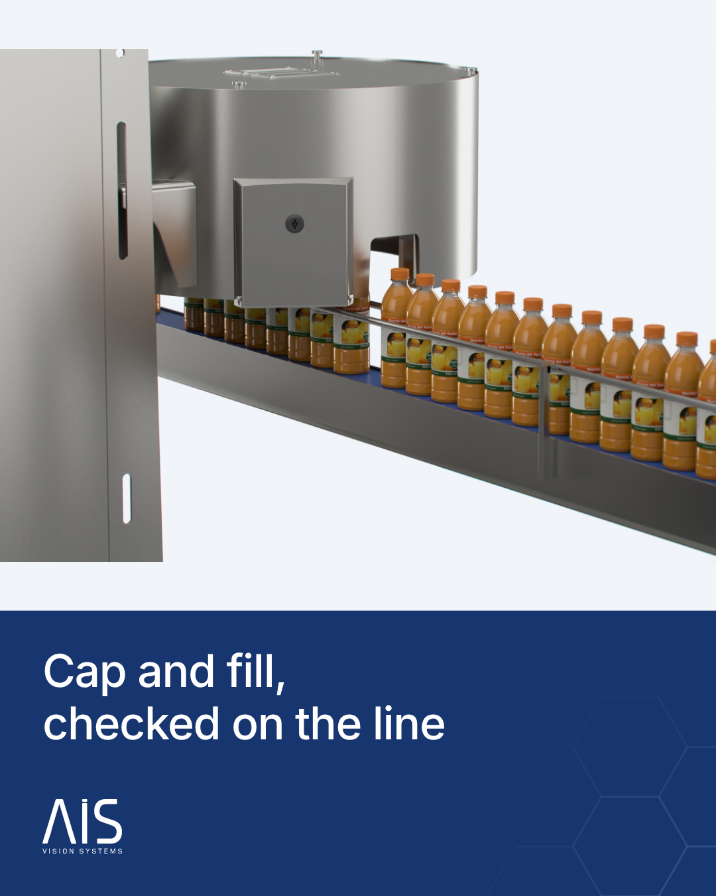

# Social media

Build posts and carousels from the approved kit and one clear message.

## How a post is built

1. The machine image fills the image band and shows the product named in the post.
2. One sentence-case headline sits on solid brand blue, without a subtitle.
3. The small white logo signs the foot. The hexagon pattern occupies the corner left free by the words.

## Formats

| Piece | Size | Notes |
| --- | --- | --- |
| Post | 1080 × 1350 px (4:5) | The default: it fills the feed on a phone |
| Square post | 1080 × 1080 px (1:1) | When a network or a partner asks for it; the photo band gets smaller |
| Link post | 1200 × 628 px (1.91:1) | Only when the post links out; the picture leads, the headline is shorter |
| Carousel | 1080 × 1350 px, 3 to 10 slides, as a PDF | Cover white or blue, content slides on white, closing on brand blue |
| Video | 9:16, 4:5, 1:1 and 16:9 | The seven types in [Video](../../brand-video/references/video.md) |

## Post and carousel types

Every post and carousel in the [Marketing kit](../../resources-assets/references/kit.md#linkedin-posts-and-carousels) is one of these types. Anything else needs a brief first.

## Do and do not

**Do**

- Lead with the real photograph
- Write the headline as the one thing the reader should remember
- Show a figure only with its basis, conditions and source
- Ask for consent from every identifiable person and approval from every customer site
- Publish the event announcement once, and the recap within a week

**Do not**

- A generated image that fails at its final size: invented text, impossible geometry, a machine that is not the one named
- Particle waves, glows, holograms or gradients
- Headlines in capitals, typed arrows, emoji or several accent colours
- Ten claims on one image, or claims the picture does not show
- The logo as the largest thing on the post

## How to make one

Ask Claude with the AIS Group Design plugin ([AI agents](../../agent-integration/references/agents.md)), giving it the photograph and the message. It starts from the template closest to the message and runs the check. It refuses rejected images, wrong names, forbidden claims and calls to action outside the approved list. Before publishing, look at the post at feed size, about 550 px wide: the headline and the proof must read there.
